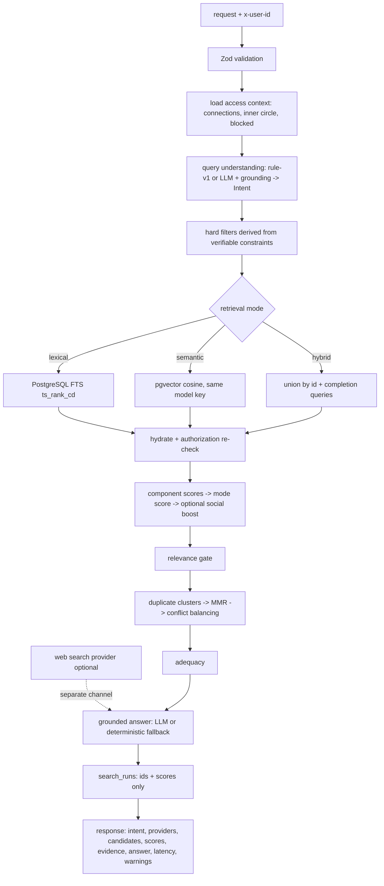
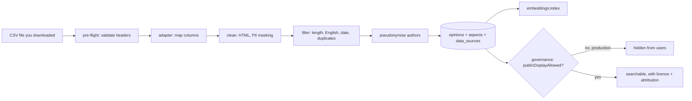

# Architecture

## Problem framing
Given a natural-language question and a requester, return the few opinions (out of a large corpus) that actually answer it — *including* negative and contradictory ones — and only then let an LLM summarise those. Three kinds of signal are kept distinct:

| signal | meaning | where it lives |
|---|---|---|
| content relevance | what an opinion says and how it answers the question | lexical FTS, embeddings, aspect lexicon, context match |
| social context | who wrote it, relationship to the requester, authorization | `social-access`, gated social boost |
| collaborative signal | patterns in real user–item interactions | **not implemented** (no interaction data) |
| web evidence | external search results | `web-search`, always a separate channel |

## Request flow (`POST /api/v1/search`)



Every SQL retrieval query contains the same authorization predicate (`authorizationSql`) and hard filters (`filterSql`), so unauthorized rows never leave PostgreSQL.

## Evidence channels
1. **inner_circle** — author is in the requester's configured inner circle.
2. **wider_social** — any other authorized opinion (other users, or the permitted public-review corpus; `sourceType` distinguishes them).
3. **web / AI** — only real provider output; `channels.web.status` is `unavailable | skipped | ok | error`. LLM text is the `answer`, never mixed into evidence.

Channels are complementary: one ranked pool is built from channels 1–2; if no inner-circle opinion is relevant the response says so (warning) and continues with channel 2 (and 3 if configured). Missing providers degrade the response with disclosed warnings, never silently.

## Modules (`src/`)

| path | responsibility |
|---|---|
| `config/env.ts` | Zod-validated environment; fails fast with actionable messages |
| `context.ts` | wires DB + providers; embedding/LLM/web status |
| `db/` | Prisma client (driver adapter), pgvector read/write helpers, seed |
| `modules/query-understanding/` | intent schema, aspect lexicon + extractor, rule parser, LLM merge with grounding |
| `modules/retrieval/` | SQL for FTS / vector / hydration; mode orchestration and explicit fallback |
| `modules/ranking/` | component scores, mode scoring, social boost, relevance gate, selection |
| `modules/social-access/` | inner-circle definition, access context, visibility predicate (TS + SQL) |
| `modules/answer/` | grounded LLM answer, deterministic fallback, citation validation |
| `modules/embeddings/`, `modules/llm/`, `modules/web-search/` | provider interfaces and implementations |
| `modules/evaluation/` | metrics (pure), data loader, runner, report renderer |
| `modules/search/` | orchestrator used by the API and the evaluator |
| `routes/`, `app.ts`, `server.ts` | Fastify API, error handling, static UI |
| `public/` | inspection UI (vanilla JS, no build step) |

## Data model (`prisma/schema.prisma`, SQL in `prisma/migrations/`)

`users` · `relationships` (type, status ACCEPTED/PENDING/BLOCKED, closeness 1–5) · `places` · `opinions` (original `text` never rewritten; `visibility`, `source_type`, `firsthand`, `provenance_*`, `repost_of_id`, generated `search_vector tsvector` + GIN index) · `opinion_aspects` (derived, per extractor) · `opinion_embeddings` (`vector`, `model`, `dim`) · `search_runs` (ids/scores/intent/provider status/latency) · `eval_queries` + `eval_judgments` (manual grades 0–3) · `evaluation_runs`.
Indexes: `(city, category)`, `(author_id, visibility)`, `written_at`, `(visibility, source_type)`, GIN on `search_vector`, `aspect`, embeddings by `model`. CHECK constraints: closeness 1–5, no self-relationship, rating 1–5, grade 0–3, `vector_dims(embedding) = dim`.

## Why `retrieve → rank → select → answer`
LLMs are strong at synthesis and weak at scanning a large corpus; retrieval quality bounds answer quality. The LLM only ever receives the handful of already-authorized, already-selected opinions (without author identities), is told to cite ids, and its output is validated (cited ids ⊆ evidence) or replaced by a deterministic summary.

## Authentication and request identity (added)

```mermaid
sequenceDiagram
  autonumber
  participant B as Browser / API client
  participant S as Fastify (security hooks)
  participant A as Auth routes
  participant DB as PostgreSQL
  B->>S: POST /api/v1/auth/login {email, password}
  S->>S: CSP/headers, CSRF origin check (cookie requests)
  S->>A: handler
  A->>A: rate limits (IP, email+IP)
  A->>DB: user by lower(email)
  A->>A: scrypt verify (dummy hash if unknown)
  A->>DB: INSERT sessions(sha256(token), expires)
  A-->>B: Set-Cookie: __Host-sos_session=token; HttpOnly; Secure; SameSite=Lax  (or token in body for mode=token)
  B->>S: POST /api/v1/search (cookie or Bearer)
  S->>A: getSession(): hash token -> sessions JOIN users, check expiry + isActive
  A-->>S: verified user id
  S->>DB: authorization-filtered retrieval (unchanged)
```

New modules: `src/modules/auth/` (password, sessions, cookies, rate-limit, service), `src/routes/auth.ts` (request authentication), `account.ts` (register/login/logout/password/delete), `social.ts` (relationships, blocks, user search, posting), `security.ts` (headers, CSRF), `src/modules/datasets/` (clean, adapters, registry, importer). New tables: `sessions`, `data_sources`; new columns: `users.email|password_hash|is_active|last_login_at`, `opinions.external_id`; `opinions.provenance_source` is now a foreign key to `data_sources`.


