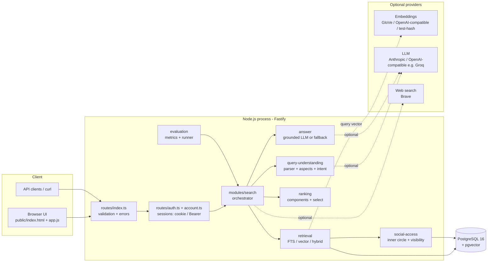
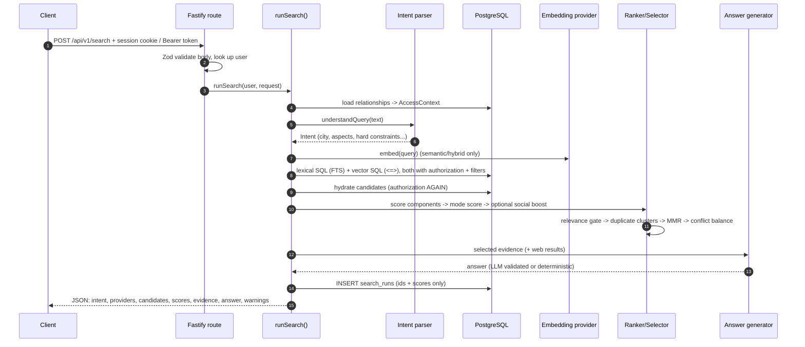
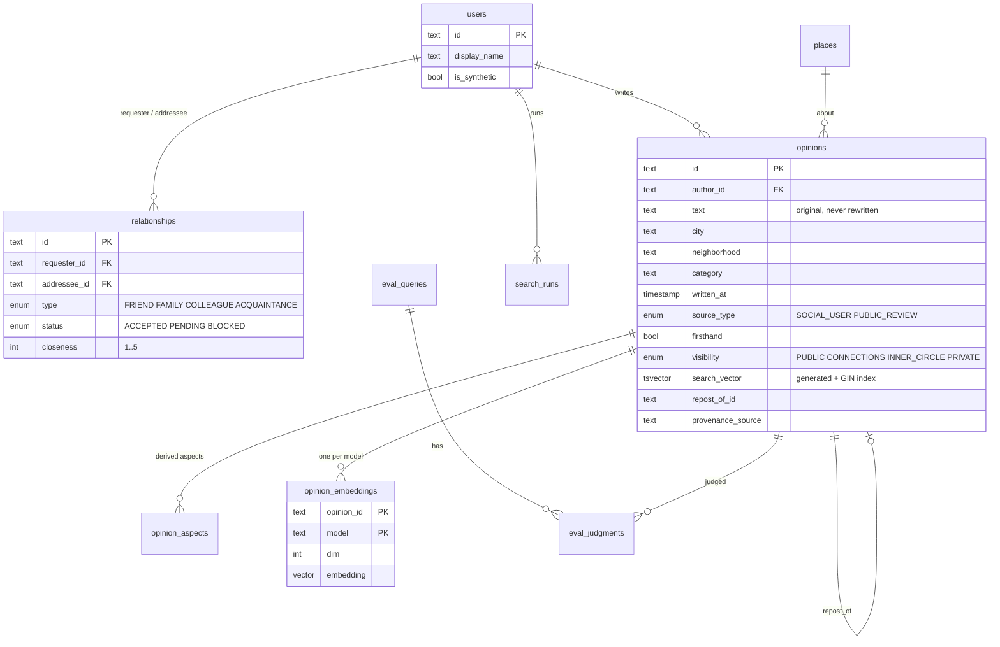
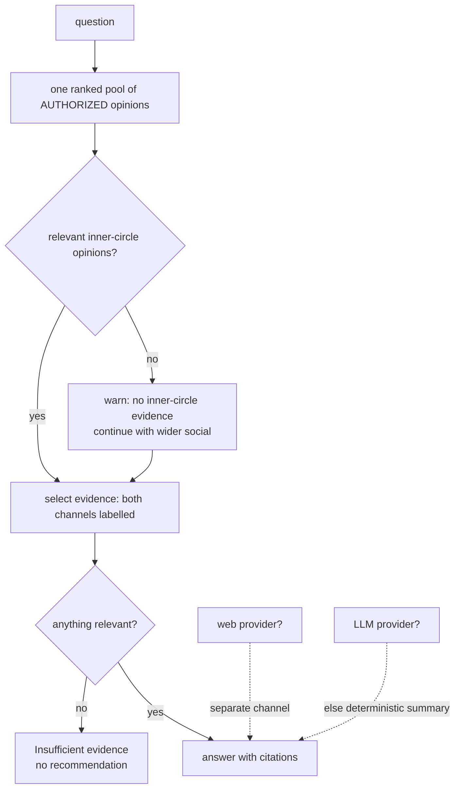
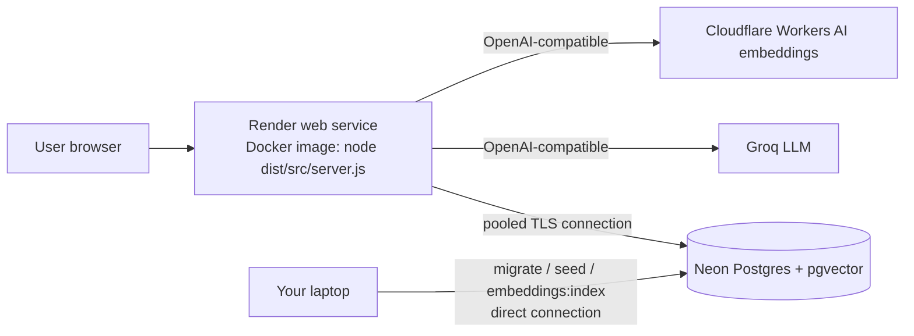
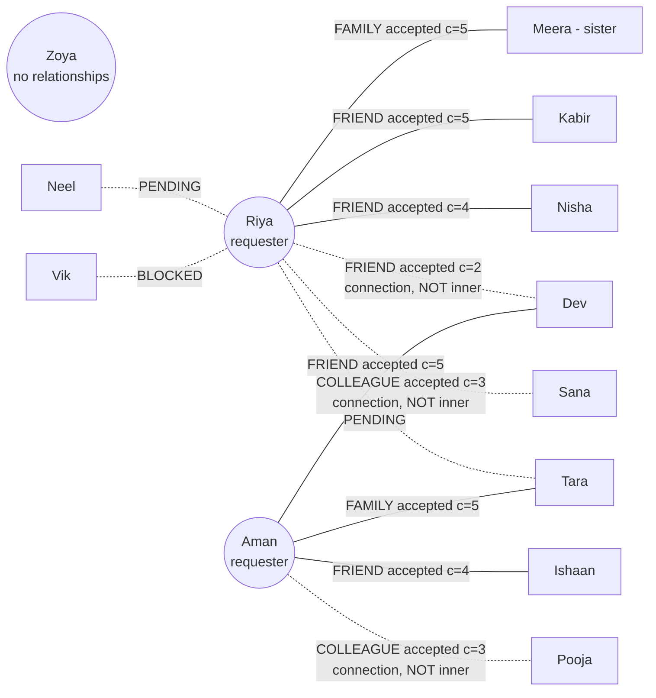
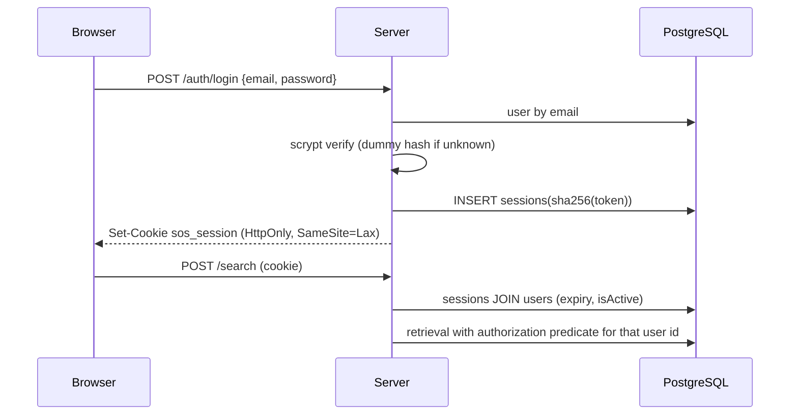

# Social Opinion Search — the complete project deep-dive

> **Purpose of this document.** Explain *everything* about the project: what every file does, how every important piece of code works, why each approach was chosen over alternatives, where the data came from (and where it did **not** come from), how the "inner circle" works, the system design thinking, and the diagrams.
>
> **Honest scope note about "every line".** The hand-written code is ~5,400 lines. Explaining each line one by one would be longer than the code and mostly noise (imports, braces, boilerplate). Instead this document does three things: (1) every file is described (§7); (2) every *non-trivial function* is explained, and the ~25 most important ones are reproduced verbatim from the source and annotated line-by-line (§8) — those excerpts are inserted automatically from the real files, so they cannot drift from the code; (3) design decisions and bug history are written down (§2, §12). Line numbers refer to the version in the zip.

**Contents**
1. What the project is
2. How the design was thought through (requirements → decisions → alternatives)
3. Architecture and diagrams (Mermaid)
4. Tech stack — what each piece is and why it was chosen
5. The data: where it came from, how it was made, what it contains
6. The social graph and the "inner circle" in detail
7. File-by-file guide
8. Key code, annotated
9. A full request, traced end to end
10. Testing strategy
11. Evaluation — method, results, how to read them
12. Development log: bugs found, wrong turns, fixes
13. Reference: configuration, API, scripts
14. Glossary
15. What is not done / next steps

---

## 1. What the project is

**Social Opinion Search** is a backend search-and-ranking engine (plus a small inspection UI) for questions such as:

> *"I'm visiting Mumbai with my sister. Find a hotel area suitable for returning late at night; consider lighting, isolation and transport."*

The task came from an assignment for a social-network company. The key insight in the brief is that **the hard part is not generating fluent text with an LLM — it is retrieving the right handful of opinions from a large corpus before the LLM sees anything.** A useful opinion may say "the road is brightly lit and taxis line up outside Leopold" or "I counted maybe three other people on the street at 1 am" without ever using the word *safety*. A keyword search misses it; a naive "send everything to the LLM" approach is slow, expensive and leaks private data.

So the system does this pipeline:

```
question ──► understand (structured intent) ──► retrieve candidates (3 ways)
         ──► rank (inspectable component scores) ──► select evidence (dedupe, diversify, keep negatives)
         ──► answer (LLM or deterministic summary, with validated citations)
```

and it enforces **who is allowed to see which opinion** at every step.

### Three kinds of signal, kept separate on purpose
| signal | meaning | in this project |
|---|---|---|
| **content relevance** | what an opinion says and how it answers *this* question | PostgreSQL full-text search, embeddings, aspect matching, context |
| **social context** | who wrote it, their relationship to you, whether you may see it | `relationships` table, authorization, optional gated ranking boost |
| **collaborative signal** | patterns in many users' interactions (people-like-you-liked) | **not implemented** — there is no interaction data, and we do not claim it |
| **web evidence** | external search results | separate channel, only if a provider is configured |

---

## 2. How the design was thought through

### 2.1 Requirements extracted from the brief
1. Query-conditioned retrieval over opinions (not a directory, not just LLM chat).
2. Three retrieval modes that are *genuinely different*: lexical, semantic (real embeddings), hybrid.
3. Inspectable ranking: every score visible, no magic.
4. Preserve negative/contradictory evidence; handle duplicates without deleting independent reports.
5. Social graph with pending vs accepted relationships and **access control before anything leaves the database or reaches an LLM**.
6. Three evidence channels (inner circle / wider social / web+AI) with graceful fallback and honesty about gaps.
7. Run without any API key (lexical baseline, tests, evaluation).
8. Mandatory offline evaluation with real metrics; never fake numbers; mark unavailable things as unavailable.
9. Runnable stack: Node + TypeScript + Fastify + PostgreSQL + Prisma + pgvector + Zod + Vitest + Docker Compose + minimal UI.

### 2.2 The key design decisions and the alternatives that were rejected

| question | chosen | alternatives considered | why |
|---|---|---|---|
| What *kind* of problem is this? | query-conditioned retrieval/ranking | collaborative filtering; plain LLM chat; plain keyword search | The brief's example needs matching *meaning in context* ("lit streets, nobody around"). CF would need interaction data we don't have and ranks taste similarity, not answers. LLM-only can't scan a large corpus and may hallucinate. |
| Where does retrieval happen? | inside PostgreSQL (FTS + pgvector) | Elasticsearch/OpenSearch + a vector DB; in-memory arrays | One database gives transactions, access control in the same SQL as retrieval, and a simple local setup (one Docker container). Fewer moving parts to explain and verify. |
| How is access control enforced? | in the SQL `WHERE` of every retrieval query **and** re-checked in TypeScript | filter after retrieval in application code only | Filtering after the fact risks leaking via scores, counts, logs or prompts. Putting it in SQL means unauthorized rows are never even fetched. The second check catches bugs in the first. |
| How are embeddings stored? | separate table, unconstrained `vector`, keyed by `(opinion_id, model)` | fixed `vector(1536)` column on `opinions` | Different providers have different dimensions; model keys make it impossible to compare vectors from different models. |
| Which embedding model? | pluggable: GloVe (local, free) / OpenAI-compatible (Cloudflare, OpenAI, Ollama…) / hash (tests only) | only OpenAI | The build environment could not reach hosted embedding APIs, but the assignment demanded *real* embeddings and an offline evaluation. GloVe (learned vectors, downloadable from GitHub) satisfied both. |
| How to pick relevant aspects ("lighting", "transport")? | a hand-written rule-based lexicon | LLM extraction; a trained classifier | Deterministic, offline, explainable, and testable. It is labelled a *heuristic* everywhere (not semantic). |
| How do negative reviews affect rank? | they don't (polarity is a display/diversity feature) | down-rank negatives | The brief says to preserve negative and contradictory evidence. Penalizing it would hide exactly what a cautious traveller needs. |
| How is "friend closeness" used? | optional, gated boost; default ranking ignores it | always boost friends | "A friend's generic opinion may be less relevant than a specific report from another source." Relevance and trust are kept distinct, and the boost can't rescue irrelevant text. |
| Migrations | hand-written SQL + a small fallback runner | only `prisma migrate dev` | Prisma can't generate generated tsvector columns, GIN indexes, pgvector or CHECK constraints; and the Prisma engine binary download was blocked in the build sandbox. |
| Evaluation data | synthetic, authored, with engineered edge cases | scrape/download a public review dataset | See §5.4. |

### 2.3 Principles applied throughout
* **Never silently switch methods.** If semantic search isn't available the API says so (503) or, if you opt in, returns a result labelled "lexical fallback".
* **Never fabricate.** No invented reviews, no invented friend endorsements, no fake web results. If evidence is thin the answer says "insufficient evidence".
* **Measure, don't assert.** Weights/thresholds were tuned only on a dev split and every number in the docs is produced by a script.
* **Every limitation is written down** (`docs/LIMITATIONS.md`).

---

## 3. Architecture and diagrams

### 3.1 Component view


### 3.2 One search request (sequence)


### 3.3 Data model (ER diagram)


### 3.4 Evidence channels and fallback


### 3.5 Deployment view


---

## 4. Tech stack — what each piece is and why

| technology | what it is | role here | why it was chosen |
|---|---|---|---|
| **TypeScript** | JavaScript plus a static type system; compiles to JavaScript | all source code | catches whole classes of bugs at compile time (`npm run typecheck`); types document data shapes (e.g. `Intent`, `ScoredCandidate`) |
| **Node.js 22** | JavaScript runtime outside the browser | runs the server and scripts | required by the brief; built-in `fetch`, `AbortSignal.timeout`, test tooling |
| **ESM modules** (`"type": "module"`) | the standard `import/export` module system | whole project; imports use `.js` suffix even in `.ts` files | modern standard; required by the Prisma 7 generated client |
| **Fastify 5** | fast Node web framework | HTTP API, static UI, error handling, body-size limit | built-in schema/hook model, low overhead, good TypeScript support |
| **PostgreSQL 16** | relational database | system of record + full-text search + vector search | one engine for relational data, FTS (`tsvector`/GIN) and (with pgvector) embeddings |
| **pgvector 0.6** | Postgres extension adding a `vector` type and distance operators (`<=>` cosine distance) | semantic retrieval | the brief's suggested approach; keeps vectors next to the data and the access rules |
| **Prisma 7** | TypeScript ORM + schema/migration tooling | typed CRUD, seeding, client generation; raw SQL for FTS/vector | typed access; `$queryRaw` with bound parameters for the parts Prisma can't express |
| **`pg` + `@prisma/adapter-pg`** | the Node Postgres driver and Prisma's driver adapter | actual DB connection (Prisma 7 requires an adapter) | Prisma 7 architecture |
| **Zod 4** | runtime schema validation library | request validation, env validation, LLM-output validation, intent schema | TypeScript types vanish at runtime; Zod validates untrusted data (HTTP bodies, model output) and infers types |
| **Vitest 5** | test runner | 179 unit + integration tests | fast, TypeScript-native, global setup for the test DB |
| **tsx** | runs TypeScript directly in Node | `npm run dev`, scripts | no separate compile step for scripts |
| **dotenv** | loads `.env` into `process.env` | config | standard |
| **Docker / Compose** | containers; run PostgreSQL+pgvector without installing it | local DB (`docker-compose.yml`) and production image (`Dockerfile`) | reproducible environment |
| **GloVe** | pretrained word vectors | local embedding provider | free, offline-capable, real learned embeddings |
| **Vanilla JS + HTML + CSS** | no framework | inspection UI | the UI exists only to expose retrieval decisions; no build step to maintain |
| **Mermaid** | text-based diagrams | this document | renders on GitHub/VS Code |
| **node:crypto scrypt** | memory-hard password-hashing function built into Node | password hashes (`src/modules/auth/password.ts`) | no native build step, parameters stored in the hash so the cost can be raised later |
| **csv-parse** | streaming CSV parser | dataset importer | handles quoted fields, embedded newlines, BOM, very large files |

TypeScript vs JavaScript, Docker, SQL concepts etc. are explained in more depth in `docs/INTERVIEW_QA.md`.

---

## 5. The data: where it came from, how it was made

### 5.1 The short, honest answer
**All data that ships in the zip is synthetic and was written by me (the AI assistant that built it). I did not download, scrape or copy any review corpus into the project.** The opinion texts, users, relationships, relevance judgments and aspect labels were authored in a one-off Python generator script and saved as JSON files that are now the source of truth. Since the update that added real accounts and datasets there are **three kinds of opinion** in the database — synthetic (`synthetic-seed-v1`), written by registered users (`user-generated`), and rows imported from public datasets that **you** download (§5.6) — each tagged with its data source.

| file | what | how many |
|---|---|---|
| `data/seed/users.json` | users (3 "requesters" you can switch to in the UI, 10 other social users, 8 "public reviewers") | 21 |
| `data/seed/relationships.json` | graph edges with type/status/closeness | 12 |
| `data/seed/places.json` | a few named places (e.g. Marine Drive promenade) | 6 |
| `data/seed/opinions.json` | the opinions | 108 |
| `data/eval/queries.json` | benchmark queries with annotated hard constraints & expected aspects | 33 |
| `data/eval/judgments.json` | graded relevance (0–3) per query/opinion | 387 pairs |
| `data/eval/aspect_labels.json` | manual aspect labels per opinion (independent of the code's lexicon) | 108 |

### 5.2 Why synthetic
1. **Legal/privacy.** A realistic *social* dataset needs real people's opinions **and real friendships**. Public review corpora (Yelp, Google, TripAdvisor) have no friendship graph, are licence-restricted, and scraping restricted sites was explicitly forbidden by the brief. Nothing legally usable could be fetched and verified in the build environment.
2. **Engineering requirement.** The brief demands test cases that real data rarely contains on purpose: exact and near duplicates, a high-rated-but-irrelevant review, contradictory reports about the same place, pending vs accepted vs blocked relationships, private opinions, a query with no answer. With synthetic data each of these is *constructed deliberately*, so tests can assert exact behaviour.
3. **Reproducibility.** Everyone gets the same 108 rows; the evaluation is repeatable.

### 5.3 How the corpus was designed
108 opinions across five cities. Each cluster was designed to exercise something:

| cluster | opinions | what it exercises |
|---|---|---|
| Mumbai hotel areas at night (`op_m01…m43`) | 43 | the headline scenario: direct matches ("well lit"), **indirect** matches (no "safety" word: "counted three other people on the street at 1 am"), negative ("dark, nobody around"), mixed ("lit main road, dark side lane"), contradictions between neighbourhoods, secondhand reports, generic praise ("very safe") that should rank below specific reports |
| Bengaluru work cafés (`op_b01…b23`) | 23 | multi-aspect queries (wifi + sockets + laptop policy), contradictory evidence about the same venue type, "didn't try the wifi" (mentions topic, no evidence) |
| Goa quiet stays (`op_g01…g15`) | 15 | noise/beach aspects, a near-duplicate with different author (`g15` copies `g11`) |
| Jaipur restaurants (`op_j01…j15`) | 15 | vegetarian/hygiene/price; an **explicit repost** (`j15` repostOf `j01`) |
| Delhi stays (`op_d01…d12`) | 12 | airport/metro access, neighborhood→city inference (Paharganj) |

Deliberate traps inside the data:
* **Exact repost:** `m20` (same author, `repostOfId = m05`). 
* **Copied wording by a different author:** `m21` copies `m01`; `b19` copies `b01`; `g15` copies `g11`. Not independent corroboration.
* **High-rated but irrelevant:** `m22` ("best hotel breakfast… five stars"), `m23` (rooftop pool), `b18` (latte art). Rating must not make them relevant to a safety question.
* **Generic friend opinion:** `m29` "Mumbai is a great city, you will love it!" by an inner-circle friend — must not outrank specific reports.
* **Visibility traps:** `m31` (pending relationship), `m32` (pending), `m33` (author blocked), `m34` (PRIVATE), `m35` (INNER_CIRCLE of a user who is only a low-closeness connection to Riya), `m36`/`m37` (unrelated users).
* **Different timestamps** from 2024 to 2026 so freshness and time-window constraints can be tested.
* **Non-firsthand** items (`m04`, `m27`, `m41`, `b16`, `j11`) to test "from people who actually stayed there".

Every row has `is_synthetic = true`, `provenance_source = "synthetic-seed-v1"` and a `provenance_note` saying it is a synthetic illustration — so nothing can be mistaken for a real person's review. Even user display names end with "(synthetic)".

### 5.4 Relevance judgments and aspect labels
* `judgments.json`: for each of the 33 queries, a list of `[opinionId, grade]` where **0 = irrelevant, 1 = tangential, 2 = relevant, 3 = highly relevant**. Only pairs with grade ≥ 1 are listed; unlisted pairs count as 0 ("pooled judgments", the standard IR practice). Rubric: 3 = specifically addresses ≥ 2 of the query's concerns with firsthand-style detail; 2 = addresses one concern specifically (this includes negative/contrary evidence and non-firsthand reports); 1 = related but not answering; 0 = other topic. Duplicates are graded like their originals.
* `aspect_labels.json`: for each opinion, which aspects it addresses, labelled by hand — deliberately **not** produced by the code's lexicon, so "aspect coverage" in the evaluation is not circular.
* **Caveat that matters:** the same author wrote the corpus, the judgments, the labels *and* the lexicon. That makes the benchmark easier than real life. The results therefore demonstrate that the pipeline behaves as designed and allow *relative* comparisons; they do not predict real-world accuracy.

### 5.5 The embedding model's data (GloVe) — the one external artifact
* **What:** GloVe "6B" vectors trained on Wikipedia 2014 + Gigaword 5 (Stanford NLP; Pennington, Socher, Manning, EMNLP 2014). Licence: Public Domain Dedication and License v1.0.
* **Where from:** the public gensim-data release on GitHub: `https://github.com/RaRe-Technologies/gensim-data/releases/download/glove-wiki-gigaword-100/glove-wiki-gigaword-100.gz` (downloaded by `scripts/fetch-glove.ts`; GitHub was reachable from the build sandbox).
* **What the script does:** streams and gunzips the file, keeps the top 100,000 most frequent words that are plain `[a-z0-9]`, writes a compact binary file (`SOSG1` format, ~41 MB) that is **not committed** (git-ignored; regenerate with `npm run embeddings:glove`).
* **How a sentence becomes a vector** (`src/modules/embeddings/glove.ts`): SIF weighting (each word weight `a/(a+p(w))`, `a = 1e-3`, word probability `p` approximated from frequency rank by Zipf's law), average, remove the common "average English" direction, normalise to length 1. These are *real learned embeddings* but **static** (one vector per word regardless of context), so weaker than modern sentence encoders — which is why the pluggable OpenAI-compatible provider exists.

### 5.6 Public datasets (added): what was searched for, what was found, what was built
I was asked for "a public pre-processed dataset". The honest account:
1. **Search.** I looked for a location-aware, English, review-style dataset I could legally redistribute and actually download from the build sandbox (which could reach GitHub, PyPI, npm and a few package hosts, but *not* Zenodo, Inside Airbnb, Kaggle, UCI or Hugging Face). GitHub licence-filtered repository searches found nothing usable.
2. **What the realistic candidates allow** (from the pages I could read): the TripAdvisor "Dyadic Context" restaurant-review dataset (Zenodo 6583422) is **CC BY-NC 4.0** (non-commercial); Inside Airbnb's data policies ask users **not to republish** the data; Yelp's dataset is research-only; scraped Booking.com/TripAdvisor/Google dumps are from restricted sources the brief told me not to use.
3. **Decision.** Shipping any of them would need redistribution rights this project does not have, and I could not download any of them anyway. So I built a **licence-aware import subsystem** (`src/modules/datasets/`, `scripts/dataset-*.ts`): you download a dataset from its official source, acknowledge its terms with `--accept-license`, and the importer maps, cleans, deduplicates, pseudonymises and stores it with full provenance. Governance flags decide whether other users may see it (`publicDisplayAllowed`) and whether commercial use is allowed.
4. **What is verified.** The importer logic is tested on **synthetic fixtures that imitate the documented layouts** (`tests/fixtures/`), including quoted newlines, HTML, PII, non-English text, duplicates and a failed-import-must-not-delete test. **It has never been run on a real dataset file.** The TripAdvisor adapter infers column names from a record description and fails loudly (printing the detected headers) if they differ.
5. **What it deliberately does not do.** It does not claim accuracy on real data: no relevance judgments exist for imported rows, so the benchmark stays pinned to the synthetic corpus and `npm run dataset:verify` prints probe-query results for a human to read.
Full detail: `docs/DATASETS.md`.

---

## 6. The social graph and the "inner circle" in detail

### 6.1 What the data actually is
There is **no algorithm that "discovers" friendships**. A relationship is a *row in the `relationships` table* — exactly like a real social network records the result of a friend request:

| column | meaning |
|---|---|
| `requester_id`, `addressee_id` | who sent / who received the request (one row per pair; unique) |
| `type` | `FRIEND`, `FAMILY`, `COLLEAGUE`, `ACQUAINTANCE` |
| `status` | `PENDING` (sent, not accepted), `ACCEPTED`, `BLOCKED` |
| `closeness` | integer 1–5: how close the two are (set by the app/user; enforced by a CHECK constraint) |

The 12 rows in the demo corpus were **authored by me** in `data/seed/relationships.json` and loaded by `npm run db:seed` — they are synthetic and do not represent real people. **Registered users now create real rows themselves** through the "My circle" tab / `POST /api/v1/relationships`: Alice sends a request (`PENDING` row), Bob accepts (`status → ACCEPTED`, `accepted_at` set, and he may adjust `type`/`closeness`), either can later edit the closeness, remove the tie, or block. The inner-circle *rule* did not change.

### 6.2 The demo graph

Solid lines = inner circle; dotted accepted = ordinary connection; PENDING/BLOCKED grant nothing.

### 6.3 The definition (configurable)
`src/modules/social-access/access.ts`:

> A person is in your **inner circle** if the relationship between you is `ACCEPTED`, its `type` is in `INNER_CIRCLE_TYPES` (default `FRIEND,FAMILY`) **and** `closeness >= INNER_CIRCLE_MIN_CLOSENESS` (default 4).

So *an accepted connection is not automatically inner circle* — Dev (closeness 2) and Sana (colleague) are Riya's connections but not inner circle. Change the two environment variables and the circle changes without touching code.

### 6.4 How it is computed (the algorithm)
`buildAccessContext(requesterId, relationshipRows, rule)`:
1. For each relationship row involving the requester, find "the other person" (works whichever side sent the request, because accepted rows are treated as **symmetric**).
2. `BLOCKED` → add to `blockedIds`. `ACCEPTED` → add to `connectionIds`, remember `closeness`, and if `isInnerCircle(...)` also add to `innerCircleIds`. `PENDING` → ignored (grants nothing).
3. Remove blocked people from the other sets.
The result (`AccessContext`) is four arrays and a closeness map. Example for Riya: connections = dev, kabir, meera, nisha, sana; **inner circle = kabir, meera, nisha**; blocked = vik; tara and neel absent.

### 6.5 How it "shows that a person is known to someone"
* **At the data level:** an `ACCEPTED` row between the two users exists (`connectionIds`), plus the rule above for inner circle.
* **At the API level:** every returned evidence item carries `channel: "inner_circle" | "wider_social"`, `authorId`, `authorName`, `sourceType`. `GET /api/v1/me/access` returns your own `connectionIds` and `innerCircleIds`, and the UI prints them under the requester dropdown. Evidence from an inner-circle author gets a purple "inner circle" chip.
* **At the ranking level:** only in `social_aware` mode does the relationship change the score (gated boost, §8.9).
* **What it does NOT prove:** it is a stored relationship flag, not evidence about the real world. It says nothing about whether the friend is a good judge of hotels. And "no friend opinion" never means "the place is bad" — the response says exactly that when the inner-circle channel is empty.

### 6.6 Opinion visibility — the other half of access control
Each opinion has a `visibility`:

| visibility | who can see it |
|---|---|
| `PUBLIC` | any requester (except the author themself and users who blocked/are blocked) |
| `CONNECTIONS` | the author's accepted connections |
| `INNER_CIRCLE` | the author's inner circle |
| `PRIVATE` | nobody else |

Worked examples (what each demo requester can see):
| opinion | Riya | Aman | Zoya |
|---|---|---|---|
| `m01` Kabir, INNER_CIRCLE | ✅ (Kabir is inner) | ❌ | ❌ |
| `m31` Tara, CONNECTIONS | ❌ (Tara is PENDING) | ✅ (Tara is Aman's accepted family) | ❌ |
| `m33` Vik, PUBLIC | ❌ (Riya blocked Vik) | ✅ | ✅ |
| `m34` Kabir, PRIVATE | ❌ | ❌ | ❌ |
| `m35` Dev, INNER_CIRCLE | ❌ (Dev is only closeness 2 to Riya) | ✅ (Dev is Aman's inner circle) | ❌ |
| `m02` public review | ✅ | ✅ | ✅ |

These exact cases are asserted by `tests/integration/privacy.test.ts`.

### 6.7 Evidence channels derived from the graph
* `inner_circle` — the opinion's author is in the requester's `innerCircleIds`.
* `wider_social` — any other authorized opinion (other users, or the public-review corpus; `sourceType` distinguishes `SOCIAL_USER` from `PUBLIC_REVIEW`).
* web/AI — a separate object; never mixed into the opinion list.


### 6.8 Who is asking? Authentication (added)
Authorization (above) needs a *verified* user id. Earlier versions trusted an `x-user-id` header; that is gone. Now:
* **Register / sign in:** email + password; password hashed with **scrypt** (N=2^15, r=8, p=1, 16-byte salt, stored as `scrypt$N$r$p$salt$hash`). Wrong password, unknown email and disabled account all return the same 401, and unknown emails still burn a hash so timing does not leak existence.
* **Sessions:** a 256-bit random token (`sos_…`); only **SHA-256(token)** is stored in `sessions`. Browser: `Set-Cookie: sos_session=…; HttpOnly; SameSite=Lax; Path=/` (in production `__Host-sos_session` with `Secure`). API clients: `"mode":"token"` returns the token for `Authorization: Bearer`.
* **Revocation:** logout deletes the row; "sign out everywhere", password change (other devices), disabling and account deletion do too.
* **Protection:** per-IP and per-(email, IP) rate limits with lockout (429 + `Retry-After`), CSRF origin check, strict CSP, nosniff, no-store for API responses.
* **Not provided:** email verification, password reset by email, MFA, a shared rate-limit store (`docs/AUTH.md` §8).

---

## 7. File-by-file guide

Legend: ★ = read this first if you only have time for a few files.

### 7.1 Root / configuration files
| file | what it does |
|---|---|
| `package.json` | project manifest: name, `"type": "module"` (ES modules), Node engine ≥ 20.11, the **scripts** (`dev`, `build`, `start`, `typecheck`, `test`, `db:*`, `embeddings:*`, `eval`, `tune`), and dependency list (Fastify, Prisma, Zod, pg, dotenv; dev: TypeScript, tsx, Vitest, types) |
| `package-lock.json` | exact resolved versions of every dependency (reproducible installs with `npm ci`) |
| `tsconfig.json` | TypeScript compiler settings: `strict`, `noUncheckedIndexedAccess` (array access may be `undefined`), `module/moduleResolution: NodeNext` (true ESM), includes src/tests/scripts |
| `tsconfig.build.json` | build-only config extending the above: emits JS into `dist/`, excludes tests |
| `vitest.config.ts` | test runner config: `tests/**/*.test.ts`, a **global setup** that prepares the test DB, serial file execution (shared DB) |
| `prisma.config.ts` | Prisma 7 config: schema path, migrations folder, datasource URL from `DATABASE_URL` |
| `.env.example` | documented template of every environment variable (copy to `.env`; `.env` is git-ignored) |
| `.gitignore` / `.dockerignore` | keep secrets, `node_modules`, `dist`, generated Prisma client, the 41 MB model file and reports out of git/Docker context |
| `docker-compose.yml` | local PostgreSQL 16 **with pgvector** (`pgvector/pgvector:pg16`), healthcheck, volume, init script mount |
| `Dockerfile` | two-stage production image: build (install, `prisma generate`, `tsc`, prune dev deps) → runtime (`node dist/src/server.js`, `HOST=0.0.0.0`, healthcheck). Not built with Docker in the authoring environment (stages simulated by hand) |
| `docker/initdb/01-init.sql` | runs once on first container start: creates the `vector` extension and the `social_opinion_test` database |
| `README.md` | setup, scripts, API, results, verification status |

### 7.2 `prisma/`
| file | what it does |
|---|---|
| ★ `prisma/schema.prisma` | the data model (tables, enums, relations, indexes). `searchVector` and `embedding` are `Unsupported(...)` types because Prisma can't model tsvector/vector natively |
| ★ `prisma/migrations/20261020000000_init/migration.sql` | the actual DDL, hand-written to match the schema **plus** what Prisma can't generate: `CREATE EXTENSION vector`, the *generated* `search_vector tsvector` column, the GIN index, `vector_dims(embedding) = dim` CHECK, rating/closeness/grade CHECKs |
| `prisma/migrations/migration_lock.toml` | tells Prisma the provider is PostgreSQL |
| `prisma/seed.ts` | CLI entry for `npm run db:seed`; calls `seedDatabase()` |

### 7.3 `data/`
| file | what it does |
|---|---|
| `data/seed/users.json`, `relationships.json`, `places.json`, `opinions.json` | the synthetic corpus (see §5) |
| `data/eval/queries.json`, `judgments.json`, `aspect_labels.json` | the benchmark (queries + manual grades + manual aspect labels) |
| `data/models/` | where the downloaded GloVe binary goes (git-ignored; only `.gitkeep` is committed) |
| `data/datasets/probe-queries.json` | the questions `npm run dataset:verify` asks of each imported dataset (for a human to read, not to score) |
| `data/datasets/raw/` | where you put dataset files you download yourself (git-ignored) |

### 7.4 `scripts/` (run with `tsx`, see package.json)
| file | what it does |
|---|---|
| `apply-migrations.ts` | plain-`pg` migration runner (tracks applied folders in `_sos_migrations`). Fallback when Prisma's engine binary can't be downloaded |
| `reset-db.ts` | drops the `public` schema and re-applies migrations (dev only; refuses in production) |
| `fetch-glove.ts` | downloads GloVe from GitHub, keeps top-100k plain words, writes the `SOSG1` binary |
| `index-embeddings.ts` | embeds every opinion missing a vector for the configured model and stores it (idempotent) |
| `run-eval.ts` | runs the benchmark, prints tables, writes `reports/latest.{json,md}`, stores a row for the API/UI |
| `tune.ts` | threshold/weight experiments: choose on **dev** queries, report on **test** queries |
| `user-admin.ts` | operator tool: create / set-password / disable / enable / list accounts (password from the `USER_PASSWORD` env var) |
| `dataset-import.ts` | `dataset:list`, `dataset:import`, `dataset:remove` (licence acknowledgement, `--limit/--sample/--only-cities/--dry-run/--embed`) |
| `dataset-download.ts` | optional https downloader with a size cap that prints the SHA-256 |
| `dataset-verify.ts` | post-import health report and probe-query spot-check (no accuracy metric, on purpose) |
| `_args.ts` | tiny argv parser shared by the scripts |

### 7.5 `src/` — application code

**Entry and wiring**
| file | what it does |
|---|---|
| ★ `src/server.ts` | process entry: validates config (fails fast with a clear message), builds providers, checks DB + pgvector, starts Fastify, prints which providers are active, handles SIGINT/SIGTERM |
| `src/app.ts` | builds the Fastify instance: 16 KB body limit, central **error handler** (Zod → 400, AppError → its status, oversize → 413, anything else → generic 500 so internals never leak), 404 handler, static UI (finds `public/` from both `src/` and `dist/src/`) |
| `src/context.ts` | the "wiring harness" `AppContext` (config, Prisma client, providers, ranking params, inner-circle rule, clock) and `getEmbeddingStatus()` which decides whether semantic retrieval is *really* available (provider configured **and** vectors exist for its model key) |
| `src/config/env.ts` | Zod schema for all environment variables; cross-field rules (e.g. `EMBEDDING_PROVIDER=openai` requires a key; the test-only provider is forbidden in production); `referenceNow()` for reproducible time |

**Database**
| file | what it does |
|---|---|
| `src/db/client.ts` | creates the `PrismaClient` with the `pg` driver adapter; re-exports `Prisma` for SQL fragments |
| `src/db/embeddings-store.ts` | raw-SQL helpers for pgvector: `toVectorLiteral`, `upsertEmbedding`, counts, "which opinions lack a vector" |
| `src/db/seed.ts` | `seedDatabase()`: truncates, inserts users/relationships/places/opinions, links reposts, extracts aspects with the lexicon, loads benchmark queries and judgments, and (optionally) creates scrypt-hashed sign-in accounts for the three demo requesters |

**Shared**
| file | what it does |
|---|---|
| `src/shared/errors.ts` | `AppError` (code + HTTP status + details) and `ProviderError` (which provider failed) |
| ★ `src/shared/text.ts` | tokenizer, small stemmer, stopwords, sentence splitter, Jaccard/shingle similarity, cosine, helpers |

**HTTP**
| file | what it does |
|---|---|
| `src/routes/auth.ts` | request authentication: reads the session cookie or `Authorization: Bearer`, looks up the hashed token, returns the verified user (`requireUser`/`requireSession`). The old `x-user-id` header is gone |
| `src/routes/account.ts` | register, login, logout, logout-all, me, change password, delete account, public auth config; rate limits and lockout |
| `src/routes/social.ts` | user search, relationships (request/accept/decline/patch/remove), blocks, post/list/delete own opinions (aspects + best-effort embedding) |
| `src/routes/security.ts` | CSP and other security headers, `no-store` for API responses, CSRF origin check |
| ★ `src/routes/index.ts` | all endpoints: `/health`, `/api/v1/search`, `/opinions` (keyset pagination), `/search-runs/:id` (owner only), `/evaluation/summary`, `/evaluation/run` (dev only), `/data-sources`, `/me/access` |

**Query understanding** (`src/modules/query-understanding/`)
| file | what it does |
|---|---|
| `intent.ts` | Zod schemas: `Intent` (topic, location, aspects, keywords, hard constraints, soft preferences, temporal, evidence characteristics, ambiguities, warnings), `LlmIntentSchema`, API `FiltersSchema`, and `deriveFilters()` that turns *verifiable* hard constraints into SQL filters |
| ★ `aspects.ts` | the aspect lexicon (20 aspects × term/positive/negative phrase lists) and `extractAspects()` (sentence-level, negation-aware polarity), `aspectsInQuery()`, `overallPolarity()` |
| ★ `parser.ts` | `parseQueryRules()` deterministic parser; `applyApiFilters()`; `understandQuery()` (rule parser first, optional LLM); `mergeLlmIntent()` (validate + **ground** LLM output against the query text) |

**Retrieval** (`src/modules/retrieval/`)
| file | what it does |
|---|---|
| `types.ts` | `OpinionRecord`, `RawCandidate`, `RetrievalResult` |
| ★ `repository.ts` | all SQL: `filterSql` (authorization + hard filters), `buildTsQuery`, `lexicalSearch`, `semanticSearch`, completion queries for hybrid, `fetchOpinions` (hydrate + re-authorize), `knownLocations` |
| ★ `retrieve.ts` | `retrieve()`: the three modes, explicit fallback/503 logic, union-by-id and score completion for hybrid, per-stage timings |

**Ranking** (`src/modules/ranking/`)
| file | what it does |
|---|---|
| `config.ts` | default weights and thresholds (with comments on which were tuned and which are a-priori) |
| `types.ts` | `ComponentScores`, `ScoredCandidate` |
| ★ `rank.ts` | component scoring, mode scoring, social boost, the relevance gate, explanations |
| ★ `select.ts` | duplicate clusters (union-find), MMR diversity, conflict balancing, adequacy |

**Authentication** (`src/modules/auth/`)
| file | what it does |
|---|---|
| `password.ts` | scrypt hash/verify (constant time, self-describing format, rehash detection), password policy |
| `sessions.ts` | token generation (256-bit, `sos_` prefix), SHA-256 token hashing, create/lookup/revoke/purge sessions |
| `cookies.ts` | parse cookies, build the HttpOnly/SameSite/`__Host-` session cookie |
| `rate-limit.ts` | fixed-window in-memory limiter (+ a no-op limiter for tests) |
| `service.ts` | Zod schemas, `registerUser`, `checkCredentials` (timing-equalised), `changePassword`, `deleteAccount` |

**Datasets** (`src/modules/datasets/`)
| file | what it does |
|---|---|
| `registry.ts` | known sources and their terms (licence, attribution, commercial use, display policy) + the Zod schema for custom sources |
| `adapters.ts` | streaming CSV reader and the TripAdvisor-Dyadic / Inside Airbnb / generic column mappers (alias-tolerant, fail loudly with detected headers) |
| `clean.ts` | HTML/entity stripping, PII masking, English heuristic, date/city/rating normalisation, dedupe keys |
| `importer.ts` | pre-flight check, licence acknowledgement, cleaning pipeline, pseudonymous authors, batched inserts, provenance update, removal |

**Other modules**
| file | what it does |
|---|---|
| ★ `social-access/access.ts` | inner-circle rule, `AccessContext`, `canViewOpinion` (TS) and `authorizationSql` (SQL) — kept equivalent by a test — and `assertAuthorized` |
| `answer/answer.ts` | LLM answer with strict prompt + citation validation, deterministic fallback, insufficient-evidence answer |
| `embeddings/provider.ts` | provider interface + factory + status type |
| `embeddings/indexer.ts` | embeds every opinion missing a vector (used by the CLI and `dataset:import --embed`) |
| `embeddings/glove.ts` | GloVe/SIF provider and the binary loader |
| `embeddings/openai.ts` | OpenAI-compatible `/embeddings` client (works for OpenAI, Cloudflare Workers AI, Ollama, vLLM…) |
| `embeddings/test-hash.ts` | **test-only** feature-hash "embeddings" so vector plumbing can be tested offline; blocked in production and never reported as semantic |
| `llm/provider.ts` | Anthropic Messages client and OpenAI-compatible chat client; JSON extraction + Zod validation + timeouts |
| `web-search/provider.ts` | Brave client; `fetchWebEvidence()` never throws (failures become a disclosed status) |
| ★ `search/search-service.ts` | `runSearch()`: orchestrates the whole pipeline and builds the response; `SearchRequestSchema` |
| `evaluation/metrics.ts` | pure metric functions (P@k, NDCG@k, recall, coverage, duplicate rate, percentile) |
| `evaluation/data.ts` | loads queries/judgments/labels; the known duplicate groups |
| ★ `evaluation/runner.ts` | runs configs × queries, computes metrics with an **independent** authorization oracle, the leak sweep, summaries |
| `evaluation/report.ts` | renders Markdown tables |

### 7.6 `public/` (UI)
| file | what it does |
|---|---|
| `index.html` | shell: sign-in/registration card, tab bar (Search · My circle · My opinions · Data sources · Evaluation · Account), search form with corpus checkboxes and result panels |
| `app.js` | session-aware single-page UI: auth screens, API client, search + pipeline inspector (with source/licence chips), circle manager, posting, data-source cards, account tab. DOM is built with `textContent` only; no inline script/style (strict CSP) |
| `styles.css` | light/dark theme via CSS variables |

### 7.7 `tests/` (179 tests in 14 files)
| file | what it covers |
|---|---|
| `global-setup.ts` | drops/rebuilds the **test** database (refuses if its name lacks "test" or equals `DATABASE_URL`), migrates, seeds, stores test-only vectors |
| `helpers.ts` | test config/context builders and a tiny in-process HTTP mock server |
| `unit/text-aspects.test.ts` | tokenizer, stemmer (incl. the "taxis" regression), aspect polarity, negation |
| `unit/intent.test.ts` | parser, constraints, unknown city, neighborhood→city, LLM grounding |
| `unit/access.test.ts` | inner-circle definition, pending/blocked, visibility matrix |
| `unit/ranking.test.ts` | component scores, mode scoring, social boost can't rescue irrelevance, duplicates, MMR, conflict balancing, adequacy |
| `unit/providers.test.ts` | env validation, GloVe, OpenAI-compatible embeddings, Anthropic/OpenAI LLM clients, web search (all against mocks) |
| `unit/answer-metrics.test.ts` | grounded answers, citation rejection, fallback, hand-computed metric values |
| `integration/search.test.ts` | real PostgreSQL: lexical/semantic/hybrid, filters, fallback labelling, end-to-end behaviours, degradation |
| `unit/auth.test.ts` | scrypt, policy, token hashing, cookies, rate limiter, auth config |
| `unit/datasets-clean.test.ts` | HTML/PII cleaning, language heuristic, dates, ratings, adapters, registry |
| `integration/auth.test.ts` | full account lifecycle on a real DB: cookies, token mode, lockout, CSRF, CSP headers, revocation, cascade delete |
| `integration/social.test.ts` | requests/accept/closeness → inner-circle visibility, blocking, posting, rate limits |
| `integration/datasets.test.ts` | importer on fixtures, idempotency, failed-import safety, restricted-source policy, benchmark isolation |
| `fixtures/` (`dyadic-sample.csv`, `airbnb-reviews.csv`, `airbnb-listings.csv`) | synthetic CSVs imitating the documented dataset layouts, with deliberately awkward rows |
| `integration/privacy.test.ts` | leak tests for every mode and requester, SQL≡TS equivalence for all users × opinions, run-log privacy |
| `integration/api-data.test.ts` | HTTP validation/limits/503, seed contents, benchmark coverage, evaluation reproducibility |

### 7.8 `docs/`
`docs/results/` holds the raw measured outputs that the evaluation text quotes: `latest.md` (full tables), `latest-summary.json` (machine-readable summary), `tune.md` (tuning experiments), `bootstrap.json` (paired bootstrap confidence intervals).

`AUTH.md`, `DATASETS.md`, `ARCHITECTURE.md`, `RANKING.md`, `EVALUATION.md`, `DECISIONS.md`, `LIMITATIONS.md`, `DEPLOYMENT.md`, this file, and `INTERVIEW_QA.md`.

---

## 8. Key code, annotated

All excerpts below are inserted verbatim from the source by a script.

### 8.1 Access control — the inner-circle rule
**`src/modules/social-access/access.ts`, lines 36–38**
```ts
export function isInnerCircle(rel: { status: string; type: string; closeness: number }, rule: InnerCircleRule): boolean {
  return rel.status === "ACCEPTED" && rule.types.includes(rel.type) && rel.closeness >= rule.minCloseness;
}
```
* One line, three conditions: **accepted**, **type allowed**, **closeness high enough**. `rule` comes from environment variables, so the definition is configurable, not hard-coded.

### 8.2 Building the requester's access context
**`src/modules/social-access/access.ts`, lines 40–66**
```ts
export function buildAccessContext(
  requesterId: string,
  rels: { requesterId: string; addresseeId: string; status: string; type: string; closeness: number }[],
  rule: InnerCircleRule,
  hiddenSources: string[] = [],
): AccessContext {
  const connections = new Set<string>();
  const inner = new Set<string>();
  const blocked = new Set<string>();
  const closeness: Record<string, number> = {};
  for (const r of rels) {
    const other = r.requesterId === requesterId ? r.addresseeId : r.requesterId;
    if (other === requesterId) continue;
    if (r.status === "BLOCKED") blocked.add(other);
    else if (r.status === "ACCEPTED") {
      connections.add(other);
      closeness[other] = r.closeness;
      if (isInnerCircle(r, rule)) inner.add(other);
    } // PENDING grants nothing
  }
  for (const b of blocked) {
    connections.delete(b);
    inner.delete(b);
  }
  for (const id of Object.keys(closeness)) if (!connections.has(id)) delete closeness[id];
  return { requesterId, connectionIds: [...connections].sort(), innerCircleIds: [...inner].sort(), blockedIds: [...blocked].sort(), closeness, hiddenSources: [...hiddenSources].sort() };
}
```
* `rels` are all rows where the requester is either side. `other` = the person on the opposite side, so a request sent *to* you counts the same as one *you* sent.
* `BLOCKED` is checked first; `ACCEPTED` fills `connections` and `closeness`; `PENDING` falls through and **grants nothing**.
* The final loop removes blocked people from `connections/inner` (a user could be both blocked and accepted through two rows).
* The result is sorted so output is deterministic (useful for tests).

### 8.3 The pure visibility predicate
**`src/modules/social-access/access.ts`, lines 77–91**
```ts
export function canViewOpinion(ctx: AccessContext, o: { authorId: string; visibility: Visibility; provenanceSource?: string }): boolean {
  if (o.authorId === ctx.requesterId) return false; // own opinions are not "social" evidence for yourself
  if (o.provenanceSource && ctx.hiddenSources.includes(o.provenanceSource)) return false; // restricted dataset: not displayable under this policy
  if (ctx.blockedIds.includes(o.authorId)) return false;
  switch (o.visibility) {
    case "PUBLIC":
      return true;
    case "CONNECTIONS":
      return ctx.connectionIds.includes(o.authorId);
    case "INNER_CIRCLE":
      return ctx.innerCircleIds.includes(o.authorId);
    case "PRIVATE":
      return false;
  }
}
```
* Own opinions are excluded (you don't need "social evidence" from yourself).
* Blocked authors are excluded even for `PUBLIC` opinions.
* `switch` on visibility; `PRIVATE` is always `false`.

### 8.4 The same rule, as SQL
**`src/modules/social-access/access.ts`, lines 98–110**
```ts
export function authorizationSql(ctx: AccessContext, alias = "o"): Prisma.Sql {
  const a = Prisma.raw(alias);
  return Prisma.sql`(
    ${a}.author_id <> ${ctx.requesterId}
    AND NOT (${a}.author_id = ANY(${ctx.blockedIds}::text[]))
    AND NOT (${a}.provenance_source = ANY(${ctx.hiddenSources}::text[]))
    AND (
      ${a}.visibility = 'PUBLIC'
      OR (${a}.visibility = 'CONNECTIONS' AND ${a}.author_id = ANY(${ctx.connectionIds}::text[]))
      OR (${a}.visibility = 'INNER_CIRCLE' AND ${a}.author_id = ANY(${ctx.innerCircleIds}::text[]))
    )
  )`;
}
```
* `Prisma.sql` template literal: every `${...}` becomes a **bound parameter** (no string concatenation → no SQL injection). `${a}` is `Prisma.raw("o")`, a fixed alias.
* `= ANY(${ctx.connectionIds}::text[])` sends the id array as one parameter.
* The third line, `NOT (provenance_source = ANY(hiddenSources))`, hides data sources whose licence forbids showing them to other users (`publicDisplayAllowed=false`) when the deployment policy says so — so a "do not republish" dataset cannot leak through search, the opinions list, evidence or answers.
* This fragment is placed in the `WHERE` of **every** retrieval query (lexical, vector, completion queries, hydration, the `/opinions` endpoint). A test proves it returns exactly the same set as `canViewOpinion` for all 21 users × 108 opinions, and mutation checks (deliberately breaking it) make the privacy tests fail.

### 8.5 Defense in depth
**`src/modules/social-access/access.ts`, lines 113–118**
```ts
export function assertAuthorized<T extends { id: string; authorId: string; visibility: Visibility; provenanceSource?: string }>(ctx: AccessContext, records: T[]): T[] {
  for (const r of records) {
    if (!canViewOpinion(ctx, r)) throw new Error(`Authorization invariant violated for opinion ${r.id}`);
  }
  return records;
}
```
* After hydration, every record is re-checked in TypeScript; any violation throws instead of continuing. Ranking, logging and LLM prompts only ever see records that passed both checks.

### 8.6 Hard filters and lexical search SQL
**`src/modules/retrieval/repository.ts`, lines 8–24**
```ts
export function filterSql(ctx: AccessContext, f: HardFilters, alias = "o"): Prisma.Sql {
  const a = Prisma.raw(alias);
  const parts: Prisma.Sql[] = [authorizationSql(ctx, alias)];
  if (f.city) parts.push(Prisma.sql`lower(${a}.city) = lower(${f.city})`);
  if (f.category) parts.push(Prisma.sql`${a}.category = ${f.category}`);
  if (f.since) parts.push(Prisma.sql`${a}.written_at >= ${f.since}::timestamp`);
  if (f.firsthandOnly) parts.push(Prisma.sql`${a}.firsthand = true`);
  if (f.sourceTypes?.length) parts.push(Prisma.sql`${a}.source_type::text = ANY(${f.sourceTypes}::text[])`);
  if (f.dataSources?.length) parts.push(Prisma.sql`${a}.provenance_source = ANY(${f.dataSources}::text[])`);
  if (f.channels?.length) {
    const wantInner = f.channels.includes("inner_circle");
    const wantWider = f.channels.includes("wider_social");
    if (wantInner && !wantWider) parts.push(Prisma.sql`${a}.author_id = ANY(${ctx.innerCircleIds}::text[])`);
    else if (wantWider && !wantInner) parts.push(Prisma.sql`NOT (${a}.author_id = ANY(${ctx.innerCircleIds}::text[]))`);
  }
  return Prisma.join(parts, " AND ");
}
```
* Starts with authorization, then appends city/category/time/firsthand/source/channel filters — all bound parameters. These are **hard constraints applied in SQL**, so a ranking score can never override them.
**`src/modules/retrieval/repository.ts`, lines 27–30**
```ts
export function buildTsQuery(keywords: string[]): string | null {
  const toks = [...new Set(keywords.map((k) => k.toLowerCase().replace(/[^a-z0-9]/g, "")).filter((k) => k.length >= 2))];
  return toks.length ? toks.join(" | ") : null;
}
```
* Keeps only `[a-z0-9]` so the string is safe for `to_tsquery`; joins with ` | ` (OR). OR (not AND) so a long natural-language question still matches opinions containing *some* of its words; ranking sorts out quality.
**`src/modules/retrieval/repository.ts`, lines 32–40**
```ts
export async function lexicalSearch(db: Db, ctx: AccessContext, f: HardFilters, tsQuery: string, limit: number): Promise<{ id: string; score: number }[]> {
  const rows = await db.$queryRaw<{ id: string; score: number }[]>(Prisma.sql`
    SELECT o.id, ts_rank_cd(o.search_vector, q.query, 32)::float8 AS score
    FROM opinions o, to_tsquery('english', ${tsQuery}) AS q(query)
    WHERE o.search_vector @@ q.query AND ${filterSql(ctx, f)}
    ORDER BY score DESC, o.id ASC
    LIMIT ${limit}`);
  return rows;
}
```
* `search_vector` is a *generated* column (`to_tsvector('english', text)`) with a GIN index. `@@` is the full-text match operator. `ts_rank_cd(..., 32)` ranks by cover density and normalises with `rank/(rank+1)` so scores are in [0,1) regardless of document length. Ties break on `id` for determinism.
**`src/modules/retrieval/repository.ts`, lines 42–50**
```ts
export async function semanticSearch(db: Db, ctx: AccessContext, f: HardFilters, modelKey: string, queryVec: number[], limit: number): Promise<{ id: string; score: number }[]> {
  const lit = toVectorLiteral(queryVec);
  return db.$queryRaw<{ id: string; score: number }[]>(Prisma.sql`
    SELECT o.id, (1 - (e.embedding <=> ${lit}::vector))::float8 AS score
    FROM opinion_embeddings e JOIN opinions o ON o.id = e.opinion_id
    WHERE e.model = ${modelKey} AND ${filterSql(ctx, f)}
    ORDER BY e.embedding <=> ${lit}::vector ASC, o.id ASC
    LIMIT ${limit}`);
}
```
* `<=>` is pgvector's **cosine distance**; `1 - distance` = cosine similarity. `WHERE e.model = ${modelKey}` guarantees we only compare vectors from the same model (so dimensions/models never mix). The query vector is passed as a text literal cast to `vector`.

### 8.7 The three retrieval modes and the fallback rules
**`src/modules/retrieval/retrieve.ts`, lines 30–97**
```ts
export async function retrieve(a: RetrieveArgs): Promise<RetrievalResult> {
  const warnings: string[] = [];
  const t = { lexical: 0, semantic: 0, embed: 0, hydrate: 0 };
  let effective = a.mode;
  let fallback: RetrievalResult["fallback"] = null;

  const needsSemantic = a.mode === "semantic" || a.mode === "hybrid";
  if (needsSemantic && (!a.embedding || !a.semanticIndexed)) {
    const reason = !a.embedding
      ? "No embedding provider is configured (EMBEDDING_PROVIDER=none), so true embedding-based semantic retrieval is unavailable."
      : `No stored embeddings exist for model ${a.embedding.modelKey}. Run \`npm run embeddings:index\`.`;
    if (!a.allowFallback) throw new AppError("SEMANTIC_RETRIEVAL_UNAVAILABLE", `${reason} Retry with mode=lexical, or pass allowFallback=true to accept an explicitly labelled lexical fallback.`, 503, { requestedMode: a.mode });
    effective = "lexical";
    fallback = { from: a.mode, to: "lexical", reason };
    warnings.push(`FALLBACK: ${reason} Results below are LEXICAL ONLY and must not be read as semantic search.`);
  }

  const tsQuery = buildTsQuery(a.intent.keywords);
  const doLex = effective === "lexical" || effective === "hybrid";
  const doSem = effective === "semantic" || effective === "hybrid";
  if (doLex && !tsQuery) warnings.push("No usable keywords for lexical retrieval.");

  let lex: { id: string; score: number }[] = [];
  let sem: { id: string; score: number }[] = [];
  let qvec: number[] | null = null;

  if (doLex && tsQuery) {
    const s = now();
    lex = await lexicalSearch(a.db, a.ctx, a.filters, tsQuery, a.poolSize);
    t.lexical = now() - s;
  }
  if (doSem && a.embedding) {
    const s = now();
    qvec = (await a.embedding.embed([a.intent.rawQuery], { inputType: "query", timeoutMs: a.timeoutMs }))[0] ?? null;
    t.embed = now() - s;
    const s2 = now();
    sem = await semanticSearch(a.db, a.ctx, a.filters, a.embedding.modelKey, qvec!, a.poolSize);
    t.semantic = now() - s2;
  }

  const byId = new Map<string, RawCandidate>();
  lex.forEach((r, i) => byId.set(r.id, { id: r.id, lexical: r.score, semantic: null, lexicalRank: i + 1, semanticRank: null, foundBy: ["lexical"] }));
  sem.forEach((r, i) => {
    const c = byId.get(r.id);
    if (c) {
      c.semantic = r.score;
      c.semanticRank = i + 1;
      c.foundBy.push("semantic");
    } else byId.set(r.id, { id: r.id, lexical: null, semantic: r.score, lexicalRank: null, semanticRank: i + 1, foundBy: ["semantic"] });
  });

  if (effective === "hybrid") {
    const s = now();
    const missingLex = [...byId.values()].filter((c) => c.lexical === null).map((c) => c.id);
    const missingSem = [...byId.values()].filter((c) => c.semantic === null).map((c) => c.id);
    if (tsQuery && missingLex.length) {
      const m = await lexicalScoresFor(a.db, a.ctx, a.filters, tsQuery, missingLex);
      for (const [id, sc] of m) byId.get(id)!.lexical = sc;
    }
    if (qvec && a.embedding && missingSem.length) {
      const m = await semanticScoresFor(a.db, a.ctx, a.filters, a.embedding.modelKey, qvec, missingSem);
      for (const [id, sc] of m) byId.get(id)!.semantic = sc;
    }
    t.hydrate = now() - s;
  }

  return { requestedMode: a.mode, effectiveMode: effective, candidates: [...byId.values()], fallback, lexicalQuery: tsQuery, timingsMs: t, warnings };
}
```
* **Availability check first**: semantic/hybrid need an embedding provider *and* stored vectors. If not available: throw `AppError(503, SEMANTIC_RETRIEVAL_UNAVAILABLE)` unless `allowFallback`, in which case the mode becomes `lexical`, `fallback` is filled in and a loud `FALLBACK` warning is added. The mode is never changed silently.
* Lexical and semantic run independently (`doLex`, `doSem`).
* **Union by id** with a `Map` → duplicates removed.
* **Completion step (hybrid only):** a candidate found only by FTS gets its cosine from a targeted query, and vice-versa, so every candidate shows both scores in the UI.
* Timings are collected per stage and returned.

### 8.8 Component scores and ranking
**`src/modules/ranking/rank.ts`, lines 19–30**
```ts
export function specificityScore(o: OpinionRecord): number {
  const t = o.text;
  const cues = [
    /\b(\d{1,2}(:\d{2})?\s?(am|pm)|\d+\s?(minutes?|mins?|hours?|nights?|days?|km|m)\b|midnight)/i.test(t),
    /(?<![.!?]\s)(?<!^)\b[A-Z][a-z]{2,}/.test(t.replace(/^\s*[A-Z]/, "x")),
    /\b(i|we|my|our)\b[^.]*\b(stayed|walked|took|waited|came back|returned|got|saw|counted|felt|asked|had|booked|tried|ordered)\b/i.test(t),
    t.split(/\s+/).length >= 25,
    o.aspects.filter((a) => !ASPECT_BY_ID.get(a.aspect)?.context).length >= 2,
  ];
  const detail = cues.filter(Boolean).length / cues.length;
  return round(0.7 * detail + 0.3 * (o.firsthand ? 1 : 0));
}
```
* Five concrete cues (a number/time, a proper noun, a first-person experience verb, ≥ 25 words, ≥ 2 aspects) → `detail`; final = 0.7 × detail + 0.3 × firsthand. A heuristic, not a validated model.
**`src/modules/ranking/rank.ts`, lines 73–182**
```ts
export function rankCandidates(a: RankArgs): ScoredCandidate[] {
  const { params: P, intent } = a;
  const recent = intent.temporal.recencyPreference === "recent";
  const w = { ...P.weights };
  if (recent) w.freshness *= P.recencyWeightMultiplier;
  const half = recent ? P.freshnessHalfLifeDays / 2 : P.freshnessHalfLifeDays;
  const contentAspects = intent.aspects.filter((x) => !ASPECT_BY_ID.get(x)?.context);
  const kwStems = [...new Set(intent.keywords.map((k) => stem(k)))];

  const out: ScoredCandidate[] = [];
  for (const raw of a.raw) {
    const o = a.records.get(raw.id);
    if (!o) continue; // not hydrated => failed authorization re-check; never ranked
    const asp = aspectScore(o, intent);
    const comps: ComponentScores = {
      lexical: raw.lexical === null ? null : round(raw.lexical),
      semantic: raw.semantic === null ? null : round(raw.semantic),
      aspect: asp.score,
      context: contextScore(o, intent),
      specificity: specificityScore(o),
      provenance: provenanceScore(o),
      freshness: freshnessScore(o, a.now, half),
      social: 0,
      redundancy: 0,
    };
    const lexV = comps.lexical ?? 0;
    const semV = Math.max(0, comps.semantic ?? 0);

    // --- relevance score by mode ---
    let relevance: number;
    if (a.mode === "lexical") relevance = lexV;
    else if (a.mode === "semantic") relevance = semV;
    else {
      const parts: [number, number][] = [
        [w.lexical, lexV],
        [w.aspect, comps.aspect ?? 0],
        [w.context, comps.context],
        [w.specificity, comps.specificity],
        [w.provenance, comps.provenance],
        [w.freshness, comps.freshness],
      ];
      // Semantic joins only if embeddings exist; the aspect weight drops out when the query has no aspects.
      let active = parts;
      if (comps.aspect === null) active = active.filter((p) => p[0] !== w.aspect);
      if (raw.semantic !== null) active = [...active, [w.semantic, semV]];
      const wsum = active.reduce((s, p) => s + p[0], 0) || 1;
      relevance = active.reduce((s, p) => s + p[0] * p[1], 0) / wsum;
    }

    // --- optional social-aware boost, gated by content relevance ---
    const channel = channelOf(a.ctx, o.authorId);
    let social = 0;
    const explanation: string[] = [];
    if (a.ranking === "social_aware") {
      const contentParts = [raw.lexical !== null ? lexV : null, raw.semantic !== null ? semV : null, comps.aspect].filter((x): x is number => x !== null);
      const contentRel = contentParts.length ? contentParts.reduce((s, x) => s + x, 0) / contentParts.length : 0;
      const gate = smoothstep((contentRel - P.socialGate.low) / (P.socialGate.high - P.socialGate.low));
      const strength = socialStrength(a.ctx, o.authorId);
      social = round(P.weights.social * strength * gate);
      if (strength > 0) explanation.push(`social context: ${channel === "inner_circle" ? "inner-circle" : "connection"} (closeness ${a.ctx.closeness[o.authorId]}), strength ${strength.toFixed(2)} × relevance gate ${gate.toFixed(2)} → +${social.toFixed(3)}`);
    }
    comps.social = social;

    // --- relevance gate (is this opinion eligible as evidence at all?) ---
    const G = P.relevanceGate;
    const matchedKeywords = kwStems.length ? kwStems.filter((k) => contentStems(o.text).includes(k)) : [];
    const matchedContentAspects = asp.matched.filter((x) => !ASPECT_BY_ID.get(x)?.context);
    let isRelevant = false;
    let reason = "";
    if (a.mode === "lexical") {
      isRelevant = lexV >= G.lexicalMin;
      reason = isRelevant ? `lexical match ${lexV.toFixed(3)} ≥ ${G.lexicalMin}` : `lexical score ${lexV.toFixed(3)} below ${G.lexicalMin}`;
    } else if (a.mode === "semantic") {
      isRelevant = semV >= G.semanticMin;
      reason = isRelevant ? `cosine ${semV.toFixed(3)} ≥ ${G.semanticMin}` : `cosine ${semV.toFixed(3)} below ${G.semanticMin}`;
    } else {
      const byAspect = matchedContentAspects.length >= G.minContentAspects && contentAspects.length > 0;
      const bySem = raw.semantic !== null && semV >= G.semanticMin;
      const byLex = lexV >= G.hybridLexicalMin;
      isRelevant = byAspect || bySem || byLex;
      reason = [byAspect && `aspects matched: ${matchedContentAspects.join(", ")}`, bySem && `cosine ${semV.toFixed(2)} ≥ ${G.semanticMin}`, byLex && `lexical ${lexV.toFixed(2)} ≥ ${G.hybridLexicalMin}`].filter(Boolean).join("; ") || "no relevance signal cleared its threshold";
    }

    // --- human-readable explanation ---
    if (raw.lexical !== null) explanation.unshift(`lexical (PostgreSQL FTS) ${lexV.toFixed(3)}${matchedKeywords.length ? ` — matched terms: ${matchedKeywords.join(", ")}` : ""}`);
    if (raw.semantic !== null) explanation.push(`semantic cosine ${(comps.semantic ?? 0).toFixed(3)}`);
    if (asp.score !== null) explanation.push(`aspect coverage ${asp.matched.length}/${intent.aspects.length}${asp.matched.length ? ` (${asp.matched.join(", ")})` : ""} [lexicon heuristic]`);
    explanation.push(o.firsthand ? "firsthand report" : "secondhand / not marked firsthand");
    if (o.repostOfId) explanation.push(`explicit repost of ${o.repostOfId} — low provenance weight`);

    const finalScore = round(relevance + social);
    out.push({
      id: o.id,
      record: o,
      raw,
      channel,
      components: comps,
      relevanceScore: round(relevance),
      finalScore,
      isRelevant,
      relevanceReason: reason,
      matchedKeywords,
      matchedAspects: asp.matched,
      aspectPolarity: intent.aspects.filter((x) => !ASPECT_BY_ID.get(x)?.context).map((x) => ({ aspect: x, polarity: o.aspects.find((y) => y.aspect === x)?.polarity ?? "NEUTRAL" })),
      explanation,
    });
  }
  out.sort((x, y) => y.finalScore - x.finalScore || x.id.localeCompare(y.id));
  return out;
}
```
Region by region:
* **Setup:** `recent` queries multiply the freshness weight (×5) and halve the half-life.
* **`if (!o) continue`:** a candidate that wasn't hydrated (failed authorization) is *never ranked*.
* **`comps`:** all nine component scores, kept for display.
* **Mode scoring:** lexical mode = `lexical`; semantic mode = `max(0, cosine)`; hybrid = weighted mean over the **available** components (the aspect weight disappears if the query has no aspects; semantic joins only if a vector exists), so weights are renormalised, not silently biased.
* **Social boost** (only when `ranking === "social_aware"`): `contentRel` = mean of the content signals; `gate = smoothstep((contentRel - 0.12)/(0.30 - 0.12))` (0 for irrelevant text, 1 for clearly relevant); `social = 0.08 × strength × gate`. Closeness can nudge near-ties but **cannot rescue irrelevant text** and cannot change eligibility.
* **Relevance gate:** decides if the opinion may become evidence at all; modes have different gates (FTS score / cosine threshold / aspect-or-cosine-or-lexical). This is what keeps a fresh, firsthand, 5-star but off-topic review out.
* **Explanation:** a human-readable list shown in the UI.

### 8.9 Evidence selection
**`src/modules/ranking/select.ts`, lines 38–51**
```ts
class UnionFind {
  private p = new Map<string, string>();
  find(x: string): string {
    if (!this.p.has(x)) this.p.set(x, x);
    let r = x;
    while (this.p.get(r) !== r) r = this.p.get(r)!;
    this.p.set(x, r);
    return r;
  }
  union(a: string, b: string) {
    const ra = this.find(a), rb = this.find(b);
    if (ra !== rb) this.p.set(rb, ra);
  }
}
```
* Tiny disjoint-set structure: opinions linked as duplicates end up in one cluster.
**`src/modules/ranking/select.ts`, lines 60–189**
```ts
export function selectEvidence(ranked: ScoredCandidate[], k: number, intent: Intent, P: RankingParams): Selection {
  const S = P.selection;
  const eligible = ranked.filter((c) => c.isRelevant);
  const contentAspects = intent.aspects.filter((a) => !ASPECT_BY_ID.get(a)?.context);

  // ---- 1. duplicate clusters (explicit repost links or near-identical wording) ----
  const sh = new Map(eligible.map((c) => [c.id, shingles(c.record.text)]));
  const uf = new UnionFind();
  const sim = new Map<string, number>();
  const explicit = new Set<string>();
  const key = (a: string, b: string) => (a < b ? `${a}|${b}` : `${b}|${a}`);
  for (let i = 0; i < eligible.length; i++) {
    const a = eligible[i]!;
    uf.find(a.id);
    for (let j = i + 1; j < eligible.length; j++) {
      const b = eligible[j]!;
      const s = jaccard(sh.get(a.id)!, sh.get(b.id)!);
      const rep = a.record.repostOfId === b.id || b.record.repostOfId === a.id;
      if (s >= S.duplicateThreshold || rep) {
        uf.union(a.id, b.id);
        sim.set(key(a.id, b.id), s);
        if (rep) explicit.add(key(a.id, b.id));
      }
    }
  }
  const groups = new Map<string, ScoredCandidate[]>();
  for (const c of eligible) {
    const r = uf.find(c.id);
    (groups.get(r) ?? groups.set(r, []).get(r)!).push(c);
  }
  const reps: ScoredCandidate[] = [];
  const suppressed: SuppressedDuplicate[] = [];
  const clusters: string[][] = [];
  for (const g of groups.values()) {
    g.sort((x, y) => y.finalScore - x.finalScore || x.id.localeCompare(y.id));
    const rep = g[0]!;
    reps.push(rep);
    if (g.length > 1) clusters.push(g.map((x) => x.id));
    for (const d of g.slice(1)) {
      const k2 = key(rep.id, d.id);
      const s = sim.get(k2) ?? Math.max(...g.filter((x) => x.id !== d.id).map((x) => sim.get(key(x.id, d.id)) ?? 0));
      const isExplicit = explicit.has(k2) || d.record.repostOfId !== null;
      suppressed.push({
        id: d.id,
        duplicateOf: rep.id,
        similarity: round(s, 3),
        explicitRepost: isExplicit,
        reason: `${isExplicit ? "explicit repost" : "near-duplicate wording"} of ${rep.id} (similarity ${s.toFixed(2)}); collapsed so repeated text is not counted as independent corroboration`,
      });
    }
  }
  reps.sort((x, y) => y.finalScore - x.finalScore || x.id.localeCompare(y.id));

  // ---- 2. MMR diversity selection over cluster representatives ----
  const topScore = reps[0]?.finalScore || 1;
  const uni = new Map(reps.map((c) => [c.id, new Set(contentStems(c.record.text))]));
  const chosen: ScoredCandidate[] = [];
  const reasons = new Map<string, string>();
  const pool = [...reps];
  const redundancy = (c: ScoredCandidate) => (chosen.length ? Math.max(...chosen.map((s) => jaccard(uni.get(c.id)!, uni.get(s.id)!))) : 0);
  while (chosen.length < k && pool.length) {
    let bestIdx = 0, bestVal = -Infinity;
    for (let i = 0; i < pool.length; i++) {
      const c = pool[i]!;
      const sameAuthor = chosen.filter((s) => s.record.authorId === c.record.authorId).length;
      const val = S.mmrLambda * (c.finalScore / topScore) - (1 - S.mmrLambda) * redundancy(c) - S.sameAuthorPenalty * sameAuthor;
      if (val > bestVal) { bestVal = val; bestIdx = i; }
    }
    const pick = pool.splice(bestIdx, 1)[0]!;
    const red = redundancy(pick);
    pick.components.redundancy = round(red);
    const rank = ranked.findIndex((r) => r.id === pick.id) + 1;
    reasons.set(pick.id, chosen.length === 0 ? `Top relevant result (rank ${rank}, score ${pick.finalScore.toFixed(3)})` : `Selected for relevance and diversity (rank ${rank}, score ${pick.finalScore.toFixed(3)}, max similarity to already-selected evidence ${red.toFixed(2)})`);
    chosen.push(pick);
  }
  for (const c of pool) c.components.redundancy = round(redundancy(c));

  // ---- 3. conflict / negative-evidence balancing (surface disagreement; never penalise polarity) ----
  const polarityOf = (c: ScoredCandidate, a: string): PolarityLabel => c.aspectPolarity.find((x) => x.aspect === a)?.polarity ?? "NEUTRAL";
  let swaps = 0;
  for (const a of contentAspects) {
    for (const want of ["neg", "pos"] as const) {
      if (swaps >= S.maxBalanceSwaps || chosen.length < 2) break;
      const test = want === "neg" ? hasNeg : hasPos;
      const other = want === "neg" ? hasPos : hasNeg;
      const selHasWanted = chosen.some((c) => test(polarityOf(c, a)));
      const selHasOther = chosen.some((c) => other(polarityOf(c, a)));
      if (selHasWanted || !selHasOther) continue; // only act if the selection is one-sided on this aspect
      const cand = pool.find((c) => test(polarityOf(c, a)));
      if (!cand) continue;
      // Replace the lowest-scored selected item whose removal does not drop an aspect's only coverage.
      const removable = [...chosen].reverse().find((c) => {
        const rest = chosen.filter((x) => x.id !== c.id);
        return contentAspects.every((asp) => !chosen.some((x) => x.id === c.id && x.matchedAspects.includes(asp)) || rest.some((x) => x.matchedAspects.includes(asp)));
      });
      if (!removable) continue;
      chosen.splice(chosen.indexOf(removable), 1, cand);
      pool.splice(pool.indexOf(cand), 1);
      reasons.delete(removable.id);
      reasons.set(cand.id, `Included to surface ${want === "neg" ? "negative" : "positive"}/conflicting evidence on "${ASPECT_BY_ID.get(a)?.label ?? a}" (the selection was otherwise one-sided)`);
      swaps++;
    }
  }
  chosen.sort((x, y) => y.finalScore - x.finalScore || x.id.localeCompare(y.id));

  // ---- 4. aspect balance + adequacy ----
  const aspectBalance: AspectBalance[] = contentAspects.map((a) => {
    const ev = chosen.filter((c) => c.matchedAspects.includes(a));
    const pols = ev.map((c) => polarityOf(c, a));
    const positive = pols.filter((p) => p === "POSITIVE").length;
    const negative = pols.filter((p) => p === "NEGATIVE").length;
    const mixed = pols.filter((p) => p === "MIXED").length;
    return { aspect: a, positive, negative, mixed, neutral: pols.length - positive - negative - mixed, conflicting: (positive > 0 && negative > 0) || mixed > 0, evidenceIds: ev.map((c) => c.id) };
  });
  const uncovered = aspectBalance.filter((b) => b.evidenceIds.length === 0).map((b) => b.aspect);
  const independent = new Set(chosen.filter((c) => c.record.firsthand && !c.record.repostOfId).map((c) => c.record.authorId)).size;
  let adequacy: Selection["adequacy"] = "insufficient";
  let note = "No opinion cleared the relevance gate for this query.";
  if (chosen.length > 0) {
    const coveredFrac = contentAspects.length ? (contentAspects.length - uncovered.length) / contentAspects.length : 1;
    if (chosen.length >= 3 && coveredFrac >= 0.5) {
      adequacy = "sufficient";
      note = `${chosen.length} relevant opinions from ${independent} distinct firsthand author(s)${uncovered.length ? `; no evidence found for: ${uncovered.join(", ")}` : ""}.`;
    } else {
      adequacy = "limited";
      note = `Only ${chosen.length} relevant opinion(s)${uncovered.length ? `; no evidence found for: ${uncovered.join(", ")}` : ""}. Treat conclusions as tentative.`;
    }
  }
  return { selected: chosen, reasons, suppressed, clusters, aspectBalance, uncoveredAspects: uncovered, independentFirsthandSources: independent, adequacy, adequacyNote: note };
}
```
Step by step:
1. **Eligible** = passed the relevance gate.
2. **Duplicate clusters:** link two opinions if one is an explicit repost of the other, or their word-bigram Jaccard similarity ≥ `duplicateThreshold` (0.5; measured gap on this corpus: duplicates ≥ 0.63, other pairs ≤ 0.14). Best-scoring member represents the cluster; the rest go to `suppressed` with a reason (they stay in the database and the response — suppressed from the *selection*, not deleted).
3. **MMR (maximal marginal relevance):** repeatedly pick the item maximising `λ·(score/topScore) − (1−λ)·maxSimilarityToChosen − 0.05·sameAuthorCount` (λ = 0.75). This prefers *new information* over a slightly higher-scored near-repeat and mildly prefers distinct authors.
4. **Conflict balancing:** for each query aspect, if the selection is one-sided (e.g. only positive on *lighting*) and an eligible unselected opinion with the opposite polarity exists, it replaces the lowest-ranked selected item that isn't the sole coverage of something (max 2 swaps). The reason is recorded ("Included to surface …").
5. **Adequacy:** `sufficient` (≥ 3 selected and ≥ half of the aspects covered), `limited`, or `insufficient` (nothing eligible → no recommendation).
6. `independentFirsthandSources` counts distinct authors of firsthand, non-repost opinions — conservative; real independence can't be proven.

### 8.10 Aspect extraction with negation
**`src/modules/query-understanding/aspects.ts`, lines 187–190**
```ts
function negated(stems: string[], pos: number): boolean {
  for (let k = Math.max(0, pos - 3); k < pos; k++) if (NEGATORS.has(stems[k] as string)) return true;
  return false;
}
```
* A cue is flipped if one of `not/no/never/without/nor/neither/hardly` appears in the preceding 3 tokens ("not dark" → favourable).
**`src/modules/query-understanding/aspects.ts`, lines 199–236**
```ts
export function extractAspects(text: string): ExtractedAspect[] {
  const sentences = splitSentences(text).map((s) => stemTokens2(s));
  const out: ExtractedAspect[] = [];
  for (const ca of COMPILED) {
    const matched = new Set<string>();
    let posSentences = 0;
    let negSentences = 0;
    let mentioned = false;
    for (const st of sentences) {
      let mention = false;
      for (const t of ca.terms) {
        if (findPhrase(st, t).length) { mention = true; matched.add(t.join(" ")); }
      }
      if (!mention) continue;
      mentioned = true;
      if (ca.def.context) continue;
      let pos = 0, neg = 0;
      for (const p of ca.pos) for (const idx of findPhrase(st, p)) negated(st, idx) ? neg++ : pos++;
      for (const n of ca.neg) for (const idx of findPhrase(st, n)) negated(st, idx) ? pos++ : neg++;
      if (pos === 0 && neg === 0) {
        for (const g of GLOBAL_POS) for (const idx of findPhrase(st, [g])) negated(st, idx) ? neg++ : pos++;
        for (const g of GLOBAL_NEG) for (const idx of findPhrase(st, [g])) negated(st, idx) ? pos++ : neg++;
      }
      if (pos > neg) posSentences++;
      else if (neg > pos) negSentences++;
      else if (pos > 0 && pos === neg) { posSentences++; negSentences++; }
    }
    if (!mentioned) continue;
    let polarity: PolarityLabel = "NEUTRAL";
    if (!ca.def.context) {
      if (posSentences && negSentences) polarity = "MIXED";
      else if (posSentences) polarity = "POSITIVE";
      else if (negSentences) polarity = "NEGATIVE";
    }
    out.push({ aspect: ca.def.id, polarity, matchedTerms: [...matched].sort() });
  }
  return out;
}
```
* Text is split into sentences and stemmed. For each aspect, a sentence that contains a term is a "mention". Positive/negative cue phrases in that sentence are counted (flipped by negation). Sentences that are positive vs negative vote; both → `MIXED`; none → `NEUTRAL`. Context aspects (e.g. `late_night`) get no polarity.
* **This is a lexicon heuristic** and says so everywhere — it is not semantic understanding.

### 8.11 Rule-based query parsing
**`src/modules/query-understanding/parser.ts`, lines 27–165**
```ts
export function parseQueryRules(query: string, ctx: ParseContext): Intent {
  const q = query.trim();
  const lower = q.toLowerCase();
  const constraints: HardConstraint[] = [];
  const soft: string[] = [];
  const ambiguities: string[] = [];
  const consumed: string[] = []; // phrases removed from keyword extraction
  let city: string | null = null;
  let neighborhood: string | null = null;

  // --- location (hard when explicit) ---
  const cityCandidates = [...ctx.cities.map((c) => [c, c] as const), ...Object.entries(CITY_ALIASES).filter(([, v]) => ctx.cities.includes(v)).map(([a, v]) => [a, v] as const)];
  for (const [alias, canonical] of cityCandidates) {
    const m = new RegExp(`\\b${esc(alias.toLowerCase())}\\b`, "i").exec(lower);
    if (m) {
      city = canonical;
      consumed.push(m[0]);
      constraints.push({ kind: "city", value: canonical, text: m[0], verifiable: true, source: "rule" });
      break;
    }
  }
  if (!city) {
    const m = /\b(?:visiting|travel(?:l)?ing to|trip to|going to|moving to|flying to|staying in|stay in)\s+([A-Z][a-zA-Z]+(?:\s+[A-Z][a-zA-Z]+)?)/.exec(q);
    if (m && !MONTHS.has(m[1]!.toLowerCase())) {
      city = m[1]!;
      consumed.push(m[1]!);
      constraints.push({ kind: "city", value: city, text: m[0], verifiable: true, source: "rule" });
      ambiguities.push(`Location "${city}" is not present in the corpus; the city filter will be enforced and may return no results.`);
    }
  }
  if (!city) {
    // A neighborhood that exists in exactly one city implies that city (explicit, logged as an inferred constraint).
    for (const [c, hoods] of Object.entries(ctx.neighborhoods)) {
      const hit = hoods.find((n) => new RegExp(`\\b${esc(n.toLowerCase())}\\b`, "i").test(lower));
      if (hit) {
        city = c;
        constraints.push({ kind: "city", value: c, text: `${hit} (neighborhood in ${c}; inferred)`, verifiable: true, source: "rule" });
        break;
      }
    }
  }
  if (city) {
    for (const n of ctx.neighborhoods[city] ?? []) {
      if (new RegExp(`\\b${esc(n.toLowerCase())}\\b`, "i").test(lower)) {
        neighborhood = n;
        break;
      }
    }
  } else {
    ambiguities.push("No location detected; searching all cities.");
  }

  // --- topic (soft context, not a filter) ---
  const topicVotes: Record<string, number> = {
    hotel_area: (lower.match(/\b(hotel|stay|staying|accommodation|guesthouse|hostel|lodging)\b/g) ?? []).length,
    cafe: (lower.match(/\b(cafe|café|coffee|cowork|co-work|work from|laptop)\b/g) ?? []).length,
    restaurant: (lower.match(/\b(restaurant|dinner|lunch|eat|eating|food|thali|meal|vegetarian|veg)\b/g) ?? []).length,
  };
  const best = Object.entries(topicVotes).sort((a, b) => b[1] - a[1])[0]!;
  const topic = best[1] > 0 ? best[0] : null;

  // --- hard constraints (verifiable) ---
  const firsthand = /\b(first-?hand|personal experiences?|actually (?:stayed|been|visited|lived|gone|went)|(?:people|those|someone|anyone) who (?:actually )?(?:stayed|visited|lived|went|have been))\b/i.exec(q);
  if (firsthand) {
    constraints.push({ kind: "firsthand_only", value: true, text: firsthand[0], verifiable: true, source: "rule" });
    consumed.push(firsthand[0]);
  }
  let since: string | null = null;
  const sinceM = /\b(?:in |over |during |within )?the (?:last|past) (\d+|a|an|one|two|three|six|nine|twelve)?\s*(week|month|year)s?\b/i.exec(q);
  if (sinceM) {
    const n = sinceM[1] ? (/^\d+$/.test(sinceM[1]) ? Number(sinceM[1]) : (NUM_WORDS[sinceM[1].toLowerCase()] ?? 1)) : 1;
    const unit = sinceM[2]!.toLowerCase();
    const d = unit === "year" ? subtractMonths(ctx.now, 12 * n) : unit === "month" ? subtractMonths(ctx.now, n) : new Date(ctx.now.getTime() - n * 7 * 86400000);
    since = isoDay(d);
    constraints.push({ kind: "since", value: since, text: sinceM[0], verifiable: true, source: "rule" });
    consumed.push(sinceM[0]);
  } else if (/\bthis year\b/i.test(q)) {
    since = `${ctx.now.getUTCFullYear()}-01-01`;
    constraints.push({ kind: "since", value: since, text: "this year", verifiable: true, source: "rule" });
    consumed.push("this year");
  }
  const channelM = /\b(?:only|just)\b[^.,;]{0,25}\b(close friends|inner circle|my circle|my family|family and friends|my friends)\b/i.exec(q);
  if (channelM) {
    constraints.push({ kind: "channel", value: ["inner_circle"], text: channelM[0], verifiable: true, source: "rule" });
    consumed.push(channelM[0]);
  }

  // --- unverifiable hard constraints (explicit "must ..." phrasing we cannot check against a stored field) ---
  let residue = q;
  for (const c of constraints) residue = residue.replace(c.text, " ");
  const re = /\b(must|has to|have to|needs? to|without)\s+([^,.;?]{3,50})/gi;
  for (let m = re.exec(residue); m; m = re.exec(residue)) {
    const text = m[0].trim();
    constraints.push({ kind: "unverifiable", value: text, text, verifiable: false, source: "rule" });
    soft.push(text);
    consumed.push(text);
  }

  // --- temporal / soft ---
  const recent = /\b(recent|recently|latest|lately|these days|nowadays|currently|up[- ]to[- ]date)\b/i.test(q);
  const comp = COMPANIONS.exec(q);
  if (comp) {
    soft.push(`travelling with ${comp[1]!.toLowerCase()}`);
    consumed.push(comp[0]);
  }

  // --- aspects (lexicon-based) ---
  const aspects = aspectsInQuery(q);
  if (aspects.length === 0) ambiguities.push("No known aspect (e.g. lighting, transport, wifi, noise) recognised; ranking relies on keywords and embeddings only.");

  // --- keywords for lexical retrieval ---
  const drop = new Set(consumed.flatMap((p) => tokenize(p)));
  const keywords: string[] = [];
  for (const t of tokenize(q)) {
    if (t.length < 3 || STOPWORDS.has(t) || QUERY_META_WORDS.has(t) || drop.has(t) || /^\d+$/.test(t)) continue;
    if (!keywords.includes(t)) keywords.push(t);
  }
  if (keywords.length === 0) ambiguities.push("No content keywords left after removing constraints; lexical retrieval will return nothing.");

  const evidence: Intent["evidenceCharacteristics"] = ["include_negative", "include_conflicting"];
  if (firsthand) evidence.push("firsthand");
  if (recent || since) evidence.push("recent");
  if (aspects.length) evidence.push("specific");

  return IntentSchema.parse({
    rawQuery: q,
    parser: "rule-v1",
    topic,
    location: { city, neighborhood },
    aspects,
    keywords,
    hardConstraints: constraints,
    softPreferences: soft,
    temporal: { recencyPreference: recent || since ? "recent" : "none", since, note: sinceM ? sinceM[0] : recent ? "recency mentioned" : null },
    evidenceCharacteristics: evidence,
    ambiguities,
    warnings: [],
  });
}
```
* City: matched against the cities that exist in the corpus (plus aliases like "bangalore"); otherwise a neighborhood implies its city; otherwise `visiting <Capitalized>` becomes an **enforced** filter for an unknown city (so "visiting Lisbon" returns *no results*, not Mumbai results).
* Topic (`hotel_area`/`cafe`/`restaurant`) is a *soft* context signal, not a filter.
* Hard constraints with regexes: firsthand-only ("people who actually stayed"), time window ("in the last 6 months" → a concrete date relative to the reference date), channel ("only my close friends" → inner circle only).
* Explicit "must/has to/without …" phrases that we **cannot check against a stored field** become `unverifiable` constraints: disclosed in warnings, never silently applied.
* Keywords for lexical search exclude constraint words, task words ("find", "suitable"), stopwords.
**`src/modules/query-understanding/parser.ts`, lines 226–274**
```ts
export function mergeLlmIntent(rule: Intent, raw: unknown, ctx: ParseContext, llmId: string): Intent {
  const llm = LlmIntentSchema.parse(raw);
  const out: Intent = structuredClone(rule);
  const q = rule.rawQuery.toLowerCase();
  out.parser = `llm:${llmId}+rule-v1-grounding`;

  // City: must be a known city AND literally present in the query (or a known alias).
  if (llm.city && !out.hardConstraints.some((c) => c.kind === "city")) {
    const known = ctx.cities.find((c) => c.toLowerCase() === llm.city!.toLowerCase());
    const alias = Object.entries(CITY_ALIASES).find(([, v]) => v.toLowerCase() === llm.city!.toLowerCase())?.[0];
    const grounded = known && (q.includes(known.toLowerCase()) || (alias && q.includes(alias)));
    if (known && grounded) {
      out.hardConstraints.push({ kind: "city", value: known, text: known, verifiable: true, source: "llm" });
      out.location.city = known;
    } else out.warnings.push(`LLM proposed city "${llm.city}" which is not a known, query-grounded city; ignored.`);
  }
  if (llm.neighborhood && !out.location.neighborhood && q.includes(llm.neighborhood.toLowerCase())) out.location.neighborhood = llm.neighborhood;

  // Aspects: canonical ids only; unknown ones become soft preferences instead of silently trusted fields.
  for (const a of llm.aspects) {
    if (ASPECT_IDS.includes(a)) {
      if (!out.aspects.includes(a)) out.aspects.push(a);
    } else if (!out.softPreferences.includes(a)) out.softPreferences.push(a);
  }

  if (llm.firsthandOnly && !out.hardConstraints.some((c) => c.kind === "firsthand_only")) {
    if (/\b(stayed|visited|lived|actually|firsthand|first-hand|personal|been there|went)\b/i.test(rule.rawQuery))
      out.hardConstraints.push({ kind: "firsthand_only", value: true, text: "llm:firsthandOnly (grounded)", verifiable: true, source: "llm" });
    else out.warnings.push("LLM suggested firsthand-only, but the query does not say so; ignored.");
  }
  if (llm.sinceDate && !out.hardConstraints.some((c) => c.kind === "since")) {
    if (/\b(last|past|since|this year|20\d\d)\b/i.test(rule.rawQuery)) {
      out.hardConstraints.push({ kind: "since", value: llm.sinceDate, text: "llm:sinceDate (grounded)", verifiable: true, source: "llm" });
      out.temporal.since = llm.sinceDate;
    } else out.warnings.push("LLM proposed a time window that the query does not state; ignored.");
  }
  if (llm.onlyInnerCircle && !out.hardConstraints.some((c) => c.kind === "channel")) {
    if (/\bonly\b|\bjust\b/i.test(rule.rawQuery) && /\b(friends|family|circle|people i know)\b/i.test(rule.rawQuery))
      out.hardConstraints.push({ kind: "channel", value: ["inner_circle"], text: "llm:onlyInnerCircle (grounded)", verifiable: true, source: "llm" });
    else out.warnings.push("LLM suggested an inner-circle-only restriction that the query does not state; ignored.");
  }
  if (llm.recencyPreference === "recent") out.temporal.recencyPreference = "recent";
  for (const u of llm.unverifiableConstraints) {
    if (!out.hardConstraints.some((c) => c.kind === "unverifiable" && c.text === u)) out.hardConstraints.push({ kind: "unverifiable", value: u, text: u, verifiable: false, source: "llm" });
  }
  for (const s of llm.softPreferences) if (!out.softPreferences.includes(s)) out.softPreferences.push(s);
  for (const a of llm.ambiguities) if (!out.ambiguities.includes(a)) out.ambiguities.push(a);
  return IntentSchema.parse(out);
}
```
* The LLM's answer is parsed by `LlmIntentSchema` (throws if structurally wrong), then **grounded**: a city must be a known city and appear in the query text; "firsthand only" needs cue words; a time window needs a time word; an inner-circle restriction needs "only/just" and "friends/family/circle". Unknown aspect ids become soft preferences. Anything rejected is explained in `warnings`.

### 8.12 Grounded answer generation
**`src/modules/answer/answer.ts`, lines 127–164**
```ts
export async function generateAnswer(args: {
  query: string;
  intent: Intent;
  evidence: EvidenceItem[];
  selection: Selection;
  web: WebEvidence;
  llm: LlmProvider | null;
  timeoutMs: number;
}): Promise<AnswerResult> {
  const { query, intent, evidence, selection, web, llm, timeoutMs } = args;
  if (evidence.length === 0) return insufficientAnswer(intent, selection, web, selection.adequacyNote);
  if (!llm) return buildDeterministicAnswer({ query, intent, evidence, selection, web });

  const allowed = new Set([...evidence.map((e) => e.id), ...web.results.map((w) => w.id)]);
  try {
    const out = await llm.generateJson({ system: SYSTEM, user: buildLlmPrompt(query, intent, evidence, web, selection), schema: LlmAnswerSchema, maxTokens: 900, timeoutMs });
    const inline = [...out.answer.matchAll(/\[([A-Za-z0-9_\-]+)\]/g)].map((m) => m[1]!);
    const bad = [...new Set([...inline, ...out.citations.map((c) => c.id)].filter((id) => !allowed.has(id)))];
    if (bad.length) {
      const fb = buildDeterministicAnswer({ query, intent, evidence, selection, web, reason: "LLM answer rejected: it cited unknown ids" });
      fb.warnings.push(`LLM answer discarded because it cited ids that are not in the selected evidence: ${bad.join(", ")}.`);
      return fb;
    }
    const ids = [...new Set([...inline, ...out.citations.map((c) => c.id)])];
    return {
      mode: "llm",
      provider: llm.id,
      text: out.answer.trim() + (/(subjective|not verified)/i.test(out.answer) ? "" : `\n\n${caveatFor(intent)}`),
      citations: ids.map((id) => ({ id, kind: web.results.some((w) => w.id === id) ? ("web" as const) : ("opinion" as const) })),
      limitations: out.limitations,
      warnings: [],
    };
  } catch (err) {
    const fb = buildDeterministicAnswer({ query, intent, evidence, selection, web, reason: "LLM unavailable" });
    fb.warnings.push(`LLM answer generation failed (${(err as Error).message}); deterministic evidence summary shown instead.`);
    return fb;
  }
}
```
* No evidence → *never* calls the LLM.
* No LLM → deterministic summary (labelled as such, with per-aspect counts, conflicts, gaps, caveat).
* LLM path: strict system prompt; only selected authorized evidence (no author identities) is sent. The model's JSON is validated; **every `[id]` it cites must be in the selected evidence** — otherwise the whole answer is discarded for the deterministic one and a warning explains why. Provider errors/timeouts also fall back with a disclosed warning.

### 8.13 Embeddings: GloVe sentence vectors
**`src/modules/embeddings/glove.ts`, lines 53–75**
```ts
  embedOne(text: string): number[] {
    const sum = new Float64Array(this.dimensions);
    let used = 0;
    for (const tok of tokenize(text)) {
      const e = this.vectors.get(tok);
      if (!e) continue;
      for (let d = 0; d < this.dimensions; d++) sum[d]! += e.weight * e.v[d]!;
      used++;
    }
    if (used === 0) throw new ProviderError("embeddings:glove", "text contains no words in the GloVe vocabulary; cannot embed");
    let dot = 0;
    for (let d = 0; d < this.dimensions; d++) {
      sum[d]! /= used;
      dot += sum[d]! * this.common[d]!;
    }
    let norm = 0;
    for (let d = 0; d < this.dimensions; d++) {
      sum[d]! -= dot * this.common[d]!;
      norm += sum[d]! * sum[d]!;
    }
    norm = Math.sqrt(norm) || 1;
    return Array.from(sum, (x) => x / norm);
  }
```
* Look up each token; weight `a/(a+p)` (rare words count more, "the" ≈ 0); sum; divide by token count; subtract the projection on the "common direction"; L2-normalise. Throws if no word is in the vocabulary (can't embed nothing).

### 8.14 The orchestrator
**`src/modules/search/search-service.ts`, lines 54–240**
```ts
export async function runSearch(ctx: AppContext, requesterId: string, req: SearchRequest, opts: SearchOptions = {}) {
  const t0 = performance.now();
  const warnings: string[] = [];
  const params = opts.params ?? ctx.params ?? DEFAULT_PARAMS;

  const user = await ctx.db.user.findUnique({ where: { id: requesterId }, select: { id: true } });
  if (!user) throw new AppError("UNKNOWN_USER", `Unknown user ${requesterId}`, 401);
  const access = await loadAccessContext(ctx.db, requesterId, ctx.circleRule, await hiddenDataSources(ctx));

  // ---- 1. query understanding ----
  const tU = performance.now();
  const known = await knownLocations(ctx.db);
  const parseCtx = { cities: known.cities, neighborhoods: known.neighborhoods, now: ctx.now() };
  let intent = opts.intent ?? (await understandQuery({ query: req.query, ctx: parseCtx, llm: ctx.llm, useLlm: ctx.config.LLM_QUERY_UNDERSTANDING, timeoutMs: ctx.config.PROVIDER_TIMEOUT_MS }));
  intent = applyApiFilters(intent, req.filters);
  const filters = deriveFilters(intent);
  const understandMs = performance.now() - tU;
  for (const c of intent.hardConstraints.filter((c) => !c.verifiable)) warnings.push(`Hard constraint "${c.text}" cannot be verified against stored fields and was NOT applied as a filter.`);
  warnings.push(...intent.warnings);

  // ---- 2. web evidence (separate channel) runs concurrently with retrieval ----
  const webPromise: Promise<WebEvidence> = req.includeWeb
    ? fetchWebEvidence(ctx.web, req.query, ctx.config.PROVIDER_TIMEOUT_MS)
    : Promise.resolve({ status: "skipped", provider: ctx.web?.id ?? "none", reason: "includeWeb=false", results: [] });

  // ---- 3. retrieval ----
  const embStatus = await getEmbeddingStatus(ctx);
  const retrieval = await retrieve({
    db: ctx.db,
    ctx: access,
    intent,
    filters,
    mode: req.mode,
    poolSize: req.candidatePool,
    allowFallback: req.allowFallback,
    embedding: ctx.embedding,
    semanticIndexed: embStatus.semanticAvailable,
    timeoutMs: ctx.config.PROVIDER_TIMEOUT_MS,
  });
  warnings.push(...retrieval.warnings);
  if (embStatus.semanticAvailable && embStatus.indexedOpinions < embStatus.totalOpinions && retrieval.effectiveMode !== "lexical") warnings.push(embStatus.reason);

  // ---- 4. hydrate (authorization re-applied in SQL and in code) + rank ----
  const tH = performance.now();
  const recs = assertAuthorized(access, await fetchOpinions(ctx.db, access, retrieval.candidates.map((c) => c.id)));
  const records = new Map(recs.map((r) => [r.id, r]));
  const hydrateMs = performance.now() - tH;
  const tR = performance.now();
  const ranked = rankCandidates({ records, raw: retrieval.candidates, intent, ctx: access, mode: retrieval.effectiveMode, ranking: req.ranking, params, now: ctx.now() });
  const rankMs = performance.now() - tR;

  // ---- 5. evidence selection ----
  const tS = performance.now();
  const selection = selectEvidence(ranked, req.limit, intent, params);
  const selectMs = performance.now() - tS;

  const innerSelected = selection.selected.filter((c) => c.channel === "inner_circle").length;
  if (selection.selected.length > 0 && innerSelected === 0) warnings.push("No relevant inner-circle opinions were found for this query; the evidence below comes from wider social/public sources only. Absence of friend opinions says nothing about the place itself.");
  if (selection.adequacy === "insufficient") warnings.push("Insufficient evidence: " + selection.adequacyNote);
  const cityC = intent.hardConstraints.find((c) => c.kind === "city");
  if (selection.adequacy === "insufficient" && cityC && !known.cities.some((x) => x.toLowerCase() === String(cityC.value).toLowerCase())) warnings.push(`No opinions exist for location "${cityC.value}" in this corpus.`);

  // ---- 6. evidence items + answer ----
  const evidence: EvidenceItem[] = selection.selected.map((c) => ({
    id: c.id,
    channel: c.channel,
    sourceType: c.record.sourceType,
    firsthand: c.record.firsthand,
    writtenAt: c.record.writtenAt.toISOString(),
    text: c.record.text,
    isSynthetic: c.record.isSynthetic,
    aspects: c.record.aspects.map((a) => ({ aspect: a.aspect, polarity: a.polarity })),
  }));
  const web = await webPromise;
  if (web.status === "error") warnings.push(`Web search failed (${web.reason}); continuing without web evidence.`);
  if (web.status === "unavailable" && req.includeWeb) warnings.push(web.reason!);

  const tA = performance.now();
  let answer: AnswerResult | null = null;
  if (req.generateAnswer) {
    answer = await generateAnswer({ query: req.query, intent, evidence, selection, web, llm: ctx.llm, timeoutMs: ctx.config.PROVIDER_TIMEOUT_MS });
    warnings.push(...answer.warnings);
  }
  const answerMs = performance.now() - tA;

  const providers = { embedding: embStatus, ...providerSummary(ctx), webSearch: { configured: !!ctx.web, provider: ctx.web?.id ?? "none", status: web.status, reason: web.reason ?? null }, intentParser: intent.parser };

  // ---- 7. response ----
  const cand = (c: ScoredCandidate, rank: number) => ({
    rank,
    opinionId: c.id,
    channel: c.channel,
    sourceType: c.record.sourceType,
    authorId: c.record.authorId,
    authorName: c.record.authorName,
    neighborhood: c.record.neighborhood,
    city: c.record.city,
    writtenAt: c.record.writtenAt.toISOString(),
    firsthand: c.record.firsthand,
    isSynthetic: c.record.isSynthetic,
    dataSource: c.record.dataSource,
    rating: c.record.rating,
    text: c.record.text,
    foundBy: c.raw.foundBy,
    components: c.components,
    relevanceScore: c.relevanceScore,
    finalScore: c.finalScore,
    eligible: c.isRelevant,
    eligibilityReason: c.relevanceReason,
    matchedKeywords: c.matchedKeywords,
    aspects: c.record.aspects,
    queryAspectPolarity: c.aspectPolarity,
    explanation: c.explanation,
  });
  const selIds = new Set(selection.selected.map((c) => c.id));
  const suppressedIds = new Map(selection.suppressed.map((s) => [s.id, s]));
  const candidates = ranked.slice(0, 40).map((c, i) => ({
    ...cand(c, i + 1),
    selected: selIds.has(c.id),
    selectionReason: selection.reasons.get(c.id) ?? suppressedIds.get(c.id)?.reason ?? (c.isRelevant ? "Eligible but not selected (lower rank or redundant with selected evidence)" : `Not eligible as evidence: ${c.relevanceReason}`),
  }));
  const selected = selection.selected.map((c) => ({ ...cand(c, ranked.indexOf(c) + 1), selectionReason: selection.reasons.get(c.id) ?? "" }));

  const latencyMs = {
    total: ms(performance.now() - t0),
    understand: ms(understandMs),
    retrieval: { ...Object.fromEntries(Object.entries(retrieval.timingsMs).map(([k, v]) => [k, ms(v)])), hydrate: ms(hydrateMs + retrieval.timingsMs.hydrate) },
    rank: ms(rankMs),
    select: ms(selectMs),
    answer: ms(answerMs),
  };

  const runId = randomUUID();
  const response = {
    runId,
    query: req.query,
    requester: { id: requesterId },
    intent,
    appliedFilters: filters,
    retrieval: {
      requestedMode: retrieval.requestedMode,
      effectiveMode: retrieval.effectiveMode,
      rankingMode: req.ranking,
      fallback: retrieval.fallback,
      lexicalQuery: retrieval.lexicalQuery,
      candidatePool: req.candidatePool,
      candidateCount: ranked.length,
      eligibleCount: ranked.filter((c) => c.isRelevant).length,
    },
    providers,
    channels: {
      inner_circle: { eligible: ranked.filter((c) => c.isRelevant && c.channel === "inner_circle").length, selected: innerSelected },
      wider_social: { eligible: ranked.filter((c) => c.isRelevant && c.channel === "wider_social").length, selected: selection.selected.length - innerSelected },
      web: { status: web.status, provider: web.provider, results: web.results, reason: web.reason ?? null },
    },
    adequacy: { status: selection.adequacy, note: selection.adequacyNote, uncoveredAspects: selection.uncoveredAspects, independentFirsthandSources: selection.independentFirsthandSources },
    aspectBalance: selection.aspectBalance.map((b) => ({ ...b, label: ASPECT_BY_ID.get(b.aspect)?.label ?? b.aspect })),
    selected,
    suppressedDuplicates: selection.suppressed,
    candidates,
    answer,
    latencyMs,
    warnings: [...new Set(warnings)],
  };

  if (opts.persist !== false) {
    // Logs hold ids, scores and metadata only — never opinion text.
    await ctx.db.searchRun.create({
      data: {
        id: runId,
        userId: requesterId,
        query: req.query,
        intent: intent as unknown as Prisma.InputJsonValue,
        retrievalMode: req.mode.toUpperCase() as "LEXICAL" | "SEMANTIC" | "HYBRID",
        rankingMode: req.ranking === "social_aware" ? "SOCIAL_AWARE" : "RELEVANCE_FIRST",
        effectiveMode: retrieval.effectiveMode,
        candidates: ranked.slice(0, 50).map((c, i) => ({ id: c.id, rank: i + 1, channel: c.channel, components: c.components, relevanceScore: c.relevanceScore, finalScore: c.finalScore, eligible: c.isRelevant })) as unknown as Prisma.InputJsonValue,
        selectedIds: selection.selected.map((c) => c.id),
        providerStatus: providers as unknown as Prisma.InputJsonValue,
        warnings: response.warnings,
        latencyMs: Math.round(latencyMs.total),
      },
    });
  }
  const internals: SearchInternals = { intent, filters, access, retrieval, ranked, selection };
  return { response, internals };
}
```
Stage markers in the code (`// ---- 1. … ----`): load access context → understand → start web search concurrently → retrieve → hydrate + `assertAuthorized` → rank → select → warnings → answer → build response → persist run. Notice that the persisted `search_runs` row contains **ids, scores and the intent only** — never opinion text.

### 8.15 Evaluation: metrics and the independent oracle
**`src/modules/evaluation/metrics.ts`, lines 18–22**
```ts
export function ndcgAtK(ranked: string[], grade: (id: string) => number, allGrades: number[], k: number): number | null {
  const ideal = dcgAtK([...allGrades].sort((a, b) => b - a), k);
  if (ideal === 0) return null; // no relevant documents: undefined
  return dcgAtK(ranked.slice(0, k).map(grade), k) / ideal;
}
```
* Exponential gain `2^grade − 1`, log2 discount, normalised by the ideal ordering of all judged documents; returns `null` (not 0) when no relevant documents exist.
**`src/modules/evaluation/runner.ts`, lines 43–53**
```ts
export function oracleCanView(requester: string, o: { authorId: string; visibility: string; provenanceSource?: string }, rels: { requesterId: string; addresseeId: string; status: string; type: string; closeness: number }[], rule: { types: string[]; min: number }, hiddenSources: string[] = []): boolean {
  if (o.authorId === requester) return false;
  if (o.provenanceSource && hiddenSources.includes(o.provenanceSource)) return false;
  const between = rels.filter((r) => (r.requesterId === requester && r.addresseeId === o.authorId) || (r.requesterId === o.authorId && r.addresseeId === requester));
  if (between.some((r) => r.status === "BLOCKED")) return false;
  const accepted = between.find((r) => r.status === "ACCEPTED");
  if (o.visibility === "PUBLIC") return true;
  if (o.visibility === "CONNECTIONS") return !!accepted;
  if (o.visibility === "INNER_CIRCLE") return !!accepted && rule.types.includes(accepted.type) && accepted.closeness >= rule.min;
  return false;
}
```
* A *second, independently written* implementation of the visibility rules (works from raw relationship rows per opinion). The evaluation uses it to zero out unauthorized documents and to count leaks, so the production authorization code is not marking its own homework.

### 8.16 The database schema (excerpt)
**`prisma/migrations/20261020000000_init/migration.sql`, lines 52–73**
```sql
CREATE TABLE "opinions" (
  "id" TEXT NOT NULL,
  "author_id" TEXT NOT NULL,
  "place_id" TEXT,
  "text" TEXT NOT NULL,
  "city" TEXT NOT NULL,
  "neighborhood" TEXT,
  "category" TEXT NOT NULL,
  "written_at" TIMESTAMP(3) NOT NULL,
  "source_type" "SourceType" NOT NULL,
  "firsthand" BOOLEAN NOT NULL,
  "visibility" "Visibility" NOT NULL,
  "rating" INTEGER,
  "provenance_source" TEXT NOT NULL,
  "provenance_note" TEXT,
  "repost_of_id" TEXT,
  "is_synthetic" BOOLEAN NOT NULL DEFAULT true,
  "created_at" TIMESTAMP(3) NOT NULL DEFAULT CURRENT_TIMESTAMP,
  "search_vector" tsvector GENERATED ALWAYS AS (to_tsvector('english', "text")) STORED,
  CONSTRAINT "opinions_pkey" PRIMARY KEY ("id"),
  CONSTRAINT "opinions_rating_range" CHECK ("rating" IS NULL OR "rating" BETWEEN 1 AND 5)
);
```
* `search_vector ... GENERATED ALWAYS AS (to_tsvector('english', "text")) STORED` — Postgres maintains the tsvector automatically whenever `text` changes; the GIN index (`opinions_search_vector_gin`) makes `@@` fast.
* CHECK constraint keeps ratings in 1..5.

### 8.17 Error handling
**`src/app.ts`, lines 29–42**
```ts
  app.setErrorHandler((err: any, req, reply) => {
    if (err instanceof ZodError) {
      return reply.status(400).send({ error: { code: "VALIDATION_ERROR", message: "Request validation failed", details: err.issues.map((i) => ({ path: i.path.join("."), message: i.message })) } });
    }
    if (err instanceof AppError) {
      const retry = (err.details as { retryAfterSeconds?: number } | undefined)?.retryAfterSeconds;
      if (err.statusCode === 429 && retry) reply.header("Retry-After", String(retry));
      return reply.status(err.statusCode).send({ error: { code: err.code, message: err.message, details: err.details } });
    }
    if (err?.code === "FST_ERR_CTP_BODY_TOO_LARGE") return reply.status(413).send({ error: { code: "PAYLOAD_TOO_LARGE", message: "Request body exceeds 16 KB" } });
    if (err?.statusCode && err.statusCode < 500) return reply.status(err.statusCode).send({ error: { code: err.code ?? "BAD_REQUEST", message: err.message } });
    req.log.error(err);
    return reply.status(500).send({ error: { code: "INTERNAL", message: "Internal server error" } }); // no internals leaked
  });
```
* Zod errors → `400 VALIDATION_ERROR` with per-field details; `AppError` → its own status/code; oversized bodies → `413`; any other error → a generic `500` (the real error is logged server-side only).

### 8.18 Password hashing
**`src/modules/auth/password.ts`, lines 19–24**
```ts
export async function hashPassword(password: string, log2N = 15): Promise<string> {
  const N = 2 ** log2N;
  const salt = randomBytes(16);
  const hash = await scrypt(password.normalize("NFKC"), salt, KEYLEN, { N, r: R, p: P, maxmem: maxmem(N) });
  return `scrypt$${N}$${R}$${P}$${salt.toString("base64")}$${hash.toString("base64")}`;
}
```
* 16 random bytes of salt per password; scrypt with N = 2^15 (memory ≈ 32 MiB), r = 8, p = 1; `NFKC` normalisation so visually identical Unicode passwords match.
* The output string carries its own parameters, so the cost can be raised later and old hashes are upgraded transparently on the next successful login (`needsRehash`).
**`src/modules/auth/password.ts`, lines 36–41**
```ts
export async function verifyPassword(password: string, stored: string): Promise<boolean> {
  const parsed = parseHash(stored);
  if (!parsed || password.length > MAX_PASSWORD_LENGTH) return false;
  const derived = await scrypt(password.normalize("NFKC"), parsed.salt, parsed.hash.length, { N: parsed.N, r: parsed.r, p: parsed.p, maxmem: maxmem(parsed.N) });
  return derived.length === parsed.hash.length && timingSafeEqual(derived, parsed.hash);
}
```
* Never throws on malformed stored hashes or oversized input (cheap early `false`); compares with `timingSafeEqual` so comparison time does not depend on how many bytes matched.

### 8.19 Looking up a session
**`src/modules/auth/sessions.ts`, lines 35–45**
```ts
export async function lookupSession(db: Db, token: string, now = new Date()): Promise<SessionUser | null> {
  if (!looksLikeToken(token)) return null;
  const tokenHash = hashToken(token);
  const s = await db.session.findUnique({ where: { tokenHash }, include: { user: { select: { id: true, displayName: true, email: true, isActive: true } } } });
  if (!s || s.expiresAt <= now || !s.user.isActive) {
    if (s && s.expiresAt <= now) await db.session.delete({ where: { tokenHash } }).catch(() => {});
    return null;
  }
  if (now.getTime() - s.lastUsedAt.getTime() > TOUCH_INTERVAL_MS) await db.session.update({ where: { tokenHash }, data: { lastUsedAt: now } }).catch(() => {});
  return { id: s.user.id, displayName: s.user.displayName, email: s.user.email, tokenHash, expiresAt: s.expiresAt };
}
```
* Format check first (so garbage never reaches the DB), then `SHA-256(token)` is the primary-key lookup — the raw token is never stored or compared.
* Expired sessions are deleted on sight; disabled accounts are rejected; `lastUsedAt` is only written every 5 minutes to avoid a write per request.

### 8.20 Security hooks (headers + CSRF)
**`src/routes/security.ts`, lines 14–47**
```ts
export function registerSecurity(app: FastifyInstance, ctx: AppContext) {
  const secure = cookieSecure(ctx.config);
  app.addHook("onSend", async (req, reply) => {
    reply.header("Content-Security-Policy", "default-src 'self'; script-src 'self'; style-src 'self'; img-src 'self' data:; connect-src 'self'; object-src 'none'; base-uri 'none'; form-action 'self'; frame-ancestors 'none'");
    reply.header("X-Content-Type-Options", "nosniff");
    reply.header("Referrer-Policy", "no-referrer");
    reply.header("Permissions-Policy", "geolocation=(), microphone=(), camera=()");
    reply.header("Cross-Origin-Opener-Policy", "same-origin");
    if (secure) reply.header("Strict-Transport-Security", "max-age=15552000; includeSubDomains");
    if (req.url.startsWith("/api/") || req.url === "/health") reply.header("Cache-Control", "no-store");
  });

  const UNSAFE = new Set(["POST", "PUT", "PATCH", "DELETE"]);
  app.addHook("onRequest", async (req) => {
    if (!UNSAFE.has(req.method)) return;
    if (typeof req.headers.authorization === "string") return; // bearer tokens are not ambient credentials => no CSRF exposure
    const origin = req.headers.origin;
    const site = req.headers["sec-fetch-site"];
    if (origin) {
      let o: URL;
      try { o = new URL(origin); } catch { throw new AppError("CSRF_BLOCKED", "Invalid Origin header.", 403); }
      // Normalise every candidate with the Origin's own scheme so default ports compare equal ("localhost:80" == "localhost" for http).
      const norm = (hostPort: string): string | null => { try { return new URL(`${o.protocol}//${hostPort}`).host; } catch { return null; } };
      const allowed = new Set<string>();
      const add = (h: unknown) => { if (typeof h === "string") { const n = norm(h); if (n) allowed.add(n); } };
      add(req.headers.host);
      if (ctx.config.PUBLIC_ORIGIN) add(new URL(ctx.config.PUBLIC_ORIGIN).host);
      if (ctx.config.TRUST_PROXY) add(req.headers["x-forwarded-host"]);
      if (!allowed.has(o.host)) throw new AppError("CSRF_BLOCKED", "Cross-origin request blocked.", 403);
    } else if (site === "cross-site") {
      throw new AppError("CSRF_BLOCKED", "Cross-site request blocked.", 403);
    }
  });
}
```
* `onSend` adds the CSP and friends to **every** response; `onRequest` runs the CSRF origin check for POST/PUT/PATCH/DELETE.
* Requests authenticated with `Authorization: Bearer` skip the check (not an ambient credential). For cookie requests, an `Origin` whose host is not the app's host (compared after normalising default ports) is rejected with 403; with no `Origin`, a `Sec-Fetch-Site: cross-site` header is rejected too.

### 8.21 Masking personal data in imported text
**`src/modules/datasets/clean.ts`, lines 23–34**
```ts
export function scrubPii(text: string): Scrubbed {
  const masked = { emails: 0, urls: 0, phones: 0, handles: 0 };
  let t = text.replace(/[A-Za-z0-9._%+-]+@[A-Za-z0-9.-]+\.[A-Za-z]{2,}/g, () => (masked.emails++, "[email]"));
  t = t.replace(/\b(?:https?:\/\/|www\.)[^\s<>")]+/gi, () => (masked.urls++, "[link]"));
  t = t.replace(/(?<![\w])\+?\d[\d\s().-]{7,}\d(?![\w])/g, (m) => {
    if ((m.match(/\d/g) ?? []).length < 9) return m; // dates, prices, short numbers stay
    masked.phones++;
    return "[phone]";
  });
  t = t.replace(/(?<![\w@])@\w{3,}/g, () => (masked.handles++, "[handle]"));
  return { text: t, masked };
}
```
* Emails, URLs, phone-like digit runs (only when ≥ 9 digits, so dates, prices and room numbers survive) and `@handles` are replaced by `[email]`, `[link]`, `[phone]`, `[handle]` and counted for the import report. **Personal names in free text are not detected.**

### 8.22 The importer
**`src/modules/datasets/importer.ts`, lines 69–171**
```ts
export async function importDataset(db: Db, o: ImportOptions): Promise<ImportReport> {
  const t0 = performance.now();
  const { meta } = o;
  if (o.acceptLicense !== meta.licenseId) throw new LicenseNotAccepted(meta);
  const adapter = ADAPTERS[meta.adapter];
  if (!adapter) throw new AdapterError(`Unknown adapter ${meta.adapter}`);
  if (o.sample !== undefined && !(o.sample > 0 && o.sample <= 1)) throw new AdapterError("--sample must be in (0, 1]");

  const minChars = o.minChars ?? 30, maxChars = o.maxChars ?? 2500;
  const listings = o.listingsFile ? await loadListings(o.listingsFile) : undefined;
  const adapterOpts: AdapterOptions = { map: o.map, city: o.city, listings, category: o.category };
  const onlyCities = o.onlyCities?.map((c) => c.toLowerCase());

  // Pre-flight: validate the layout of the first file (and its first row) BEFORE anything destructive happens,
  // so a wrong file or wrong --map never wipes data that was imported earlier.
  if (o.files.length === 0) throw new AdapterError("No input files given.");
  for await (const row of readCsv(o.files[0]!)) { adapter.prepare(Object.keys(row), adapterOpts); break; }

  if (!o.dryRun) {
    await upsertSource(db, meta);
    if (!o.append) await removeDataset(db, meta);
  }

  // Pseudonymisation key: random per import run and never stored => pseudonyms cannot be reversed or linked across imports.
  const key = randomBytes(32);
  const pseudonym = (k: string) => createHmac("sha256", key).update(`${meta.id}|${k}`).digest("hex").slice(0, 12);

  const report: ImportReport = { source: meta.id, dryRun: !!o.dryRun, filesRead: 0, rowsRead: 0, kept: 0, skipped: {}, cities: {}, dateFrom: null, dateTo: null, masked: { emails: 0, urls: 0, phones: 0, handles: 0, rowsWithMasking: 0 }, aspectRows: 0, durationMs: 0 };
  const skip = (why: string) => { report.skipped[why] = (report.skipped[why] ?? 0) + 1; };
  const seenText = new Set<string>();
  const seenIds = new Set<string>();
  let users: Prisma.UserCreateManyInput[] = [];
  let opinions: Prisma.OpinionCreateManyInput[] = [];
  let aspects: Prisma.OpinionAspectCreateManyInput[] = [];
  const flush = async () => {
    if (o.dryRun || opinions.length === 0) { users = []; opinions = []; aspects = []; return; }
    await db.user.createMany({ data: users, skipDuplicates: true });
    await db.opinion.createMany({ data: opinions, skipDuplicates: true });
    if (aspects.length) await db.opinionAspect.createMany({ data: aspects, skipDuplicates: true });
    users = []; opinions = []; aspects = [];
  };

  outer: for (const file of o.files) {
    report.filesRead++;
    let mapper: ReturnType<typeof adapter.prepare> | null = null;
    for await (const row of readCsv(file)) {
      mapper ??= adapter.prepare(Object.keys(row), adapterOpts);
      report.rowsRead++;
      if (report.rowsRead % 5000 === 0) o.onProgress?.(report.rowsRead, report.kept);
      const m = mapper(row);
      if ("skip" in m) { skip(m.skip); continue; }
      const r: RawReview = m;
      if (onlyCities && !onlyCities.includes(r.city.toLowerCase())) { skip("city_filtered"); continue; }
      if (o.sample !== undefined && o.sample < 1 && parseInt(shortHash(r.externalId, 8), 16) / 0xffffffff >= o.sample) { skip("sampled_out"); continue; }

      const cleaned = normalizeText(r.text);
      const scrub = scrubPii(cleaned);
      const text = scrub.text;
      if (text.length < minChars) { skip("too_short"); continue; }
      if (text.length > maxChars) { skip("too_long"); continue; }
      if (!looksEnglish(text)) { skip("not_english"); continue; }
      const dk = dedupeKey(text);
      if (seenText.has(dk)) { skip("duplicate_text"); continue; }
      const opId = `op_${meta.shortCode}_${shortHash(r.externalId, 14)}`;
      if (seenIds.has(opId)) { skip("duplicate_id"); continue; }
      seenText.add(dk); seenIds.add(opId);

      const total = scrub.masked.emails + scrub.masked.urls + scrub.masked.phones + scrub.masked.handles;
      if (total) report.masked.rowsWithMasking++;
      report.masked.emails += scrub.masked.emails; report.masked.urls += scrub.masked.urls; report.masked.phones += scrub.masked.phones; report.masked.handles += scrub.masked.handles;

      const authorHex = pseudonym(r.authorKey ?? r.externalId);
      const authorId = `pub_${meta.shortCode}_${authorHex}`;
      users.push({ id: authorId, displayName: `Public reviewer ${authorHex.slice(0, 6)} (${meta.shortCode})`, isSynthetic: false });
      opinions.push({
        id: opId, authorId, text, city: r.city, neighborhood: r.neighborhood ?? null, category: r.category, writtenAt: r.writtenAt, sourceType: "PUBLIC_REVIEW",
        firsthand: meta.assumeFirsthand, visibility: "PUBLIC", rating: r.rating ?? null, provenanceSource: meta.id, externalId: r.externalId, isSynthetic: false,
        provenanceNote: `Imported from "${meta.name}" (${meta.license}). Cleaned: HTML removed, emails/links/phone-like numbers/@handles masked. Reviewer identity pseudonymised.`,
      });
      for (const a of extractAspects(text)) { aspects.push({ opinionId: opId, aspect: a.aspect, polarity: a.polarity, matchedTerms: a.matchedTerms, extractor: "lexicon-v1" }); report.aspectRows++; }

      report.kept++;
      report.cities[r.city] = (report.cities[r.city] ?? 0) + 1;
      const iso = r.writtenAt.toISOString();
      if (!report.dateFrom || iso < report.dateFrom) report.dateFrom = iso;
      if (!report.dateTo || iso > report.dateTo) report.dateTo = iso;
      if (opinions.length >= BATCH) await flush();
      if (o.limit && report.kept >= o.limit) break outer;
    }
  }
  await flush();

  if (!o.dryRun) {
    const count = await db.opinion.count({ where: { provenanceSource: meta.id } });
    const cityList = Object.keys(report.cities).sort().join(", ");
    await db.dataSource.update({
      where: { id: meta.id },
      data: { rowCount: count, importedAt: new Date(), dateFrom: report.dateFrom ? new Date(report.dateFrom) : null, dateTo: report.dateTo ? new Date(report.dateTo) : null, geography: cityList ? `${cityList} (as imported)` : meta.geography ?? null },
    });
  }
  report.durationMs = Math.round(performance.now() - t0);
  return report;
}
```
* Licence acknowledgement is the first line of defence (`LicenseNotAccepted`). The **pre-flight** block validates the first file's headers before anything is deleted (a test found that the original version wiped earlier data when given a wrong file).
* The random HMAC key for author pseudonyms lives only in memory for the duration of the run.
* Per row: adapter mapping → filters (city, deterministic sampling) → HTML/PII cleaning → length/English/duplicate checks → opinion + pseudonymous author + aspects; batches of 500 are written with `skipDuplicates`.
* At the end the `data_sources` row is updated with counts, date range and cities.

---

## 9. A full request, traced end to end (real output)

Request: user `u_riya`, mode `hybrid`, ranking `relevance_first`, GloVe embeddings, query *"I'm visiting Mumbai with my sister. Find a hotel area suitable for returning late at night; consider lighting, isolation and transport."* The numbers below were produced by actually running the code on the seeded database.

**Step 1 — authentication.** `getSession()` takes the session cookie (or Bearer token), hashes it with SHA-256, joins `sessions` to `users`, checks expiry and `isActive`, and yields the verified user id `u_riya`. (This trace was captured before accounts existed, when the id came from a header; everything after this step is unchanged.)
**Step 2 — validation.** `SearchRequestSchema` (Zod, `.strict()`): query 3–500 chars, mode/ranking enums, `limit` 1–10, etc. Unknown fields → `400`.
**Step 3 — access context.** Riya's relationships are loaded; result: inner circle = `u_kabir, u_meera, u_nisha`; other connections = `u_dev, u_sana`; blocked = `u_vik`; Tara/Neel (pending) absent.
**Step 4 — intent.** Rule parser output:
* location: `Mumbai` → hard constraint `city=Mumbai` (verifiable, source `rule`)
* aspects: `late_night, lighting, activity_isolation, transport`
* keywords: `hotel, returning, late, night, lighting, isolation, transport` (note: `mumbai` and `sister` removed — one became a filter, the other a soft preference `travelling with sister`)
* generated `tsquery`: `hotel | returning | late | night | lighting | isolation | transport`
**Step 5 — retrieval.** Query embedded with GloVe; FTS + vector SQL, both including the authorization predicate and `lower(city) = 'mumbai'`; union → **36 candidates** (all Mumbai opinions Riya may see). Hybrid completion fills missing component scores.
**Step 6 — ranking.** Top of the ranked list (columns = lexical, semantic cosine, aspect coverage, context, specificity, provenance, freshness, final):

| rank | id | channel | lex | sem | asp | ctx | spec | prov | fresh | final |
|---|---|---|---|---|---|---|---|---|---|---|
| 1 | m01 | inner_circle | 0.17 | 0.53 | 1.00 | 0.83 | 1.00 | 1.00 | 0.88 | 0.668 |
| 2 | m26 | wider_social | 0.09 | 0.60 | 1.00 | 0.83 | 0.86 | 1.00 | 0.46 | 0.645 |
| 3 | m08 | inner_circle | 0.09 | 0.58 | 1.00 | 0.83 | 0.86 | 1.00 | 0.57 | 0.641 |
| 4 | m05 | inner_circle | 0.09 | 0.47 | 1.00 | 0.83 | 1.00 | 1.00 | 0.91 | 0.635 |
| 5 | **m12** | wider_social | **–** | 0.61 | 1.00 | 0.83 | 0.86 | 0.80 | 0.66 | 0.619 |
| 6 | m14 | wider_social | 0.17 | 0.66 | 0.75 | 0.83 | 0.72 | 1.00 | 0.76 | 0.615 |
| 7 | m39 | wider_social | 0.17 | 0.54 | 1.00 | 0.83 | 0.58 | 0.80 | 0.81 | 0.610 |
| 8 | m21 | wider_social | 0.17 | 0.56 | 0.75 | 0.83 | 1.00 | 0.80 | 0.91 | 0.609 |

Notice **m12** ("…roads are busy and well lit even at 1 am because of airport traffic"): its lexical score is `–` (no keyword in common — it never says "lighting", "isolation" or "transport"), yet it ranks 5th thanks to the embedding and the aspect lexicon. That is the "indirect match" the brief asks for.
**Step 7 — selection.** 33 of 36 candidates were eligible. Duplicate handling: **`m21` collapsed into `m01`** (copied wording, similarity 0.627) and **`m20` into `m05`** (explicit repost, 0.691). MMR + balancing selected `m01, m26, m08, m05, m12, m14` — 3 inner-circle and 3 wider-social, from 6 distinct firsthand authors.
**Step 8 — aspect balance.** All three aspects flagged `CONFLICT`: e.g. *foot traffic/isolation* has 3 favourable (m01, m08, m12) and 2 unfavourable (m26, m14). Contradictory evidence is surfaced, not hidden.
**Step 9 — adequacy.** `sufficient — 6 relevant opinions from 6 distinct firsthand author(s)`.
**Step 10 — answer.** No LLM configured → deterministic evidence summary (labelled), with per-aspect counts, the conflicts, citations and the caveat *"Reviews cannot establish that an area is objectively safe or unsafe."* With a Groq key the LLM would write prose instead, but only from these 6 items and only citing these ids.
**Step 11 — warnings.** Only "No web-search provider configured…" (the web channel is honestly marked unavailable).
**Step 12 — logging.** A `search_runs` row with ids, scores, intent, provider status, latency — no text.

**Two honest quirks visible in this trace** (both are lexicon limitations, documented in LIMITATIONS):
1. `m08` ("Street lights were working…") shows *lighting: neutral* because the lexicon's positive phrase is "working streetlight", which doesn't match "street lights were working".
2. `m05` shows *foot traffic: mixed* because "I came back **alone**…" contains the negative cue "alone" while "busy until 1 am" is a positive cue in the same opinion.

---

## 10. Testing strategy

**179 tests in 14 files**, 8 unit (no DB) + 6 integration (real PostgreSQL + pgvector).

* **Deterministic fixtures:** the test DB is rebuilt from the seed on every run; the "embeddings" in tests come from the *test-only* hash provider; time is pinned via `REFERENCE_DATE`.
* **Mock servers instead of live providers:** `tests/helpers.ts` starts a tiny HTTP server; provider tests assert the exact request shape (URL, headers, body) and how responses/errors are handled. **This proves our code speaks the protocol; it does not prove the live services behave as expected.**
* **Privacy tests** (the most important): for every retrieval mode × ranking mode, assert that pending/blocked/private/non-inner-circle opinions never appear in candidates, selected evidence, suppressed duplicates, the raw JSON body, run logs, the evaluation summary, or the LLM prompt. An equivalence test compares the SQL predicate with the TypeScript predicate for all users × opinions.
* **Mutation checks (done manually):** I deliberately broke the authorization code twice (removed the CONNECTIONS check in SQL; treated PENDING as ACCEPTED) and confirmed 5–7 tests fail each time, then restored the code. A test suite that cannot fail proves nothing.
* **Regression test from a real bug:** the stemmer bug (§12).
* **Safety rail:** the test setup drops the `public` schema, so it refuses to run unless `TEST_DATABASE_URL` points at a database whose name contains "test" and differs from `DATABASE_URL`.
* **Skipped-loudly rule:** if PostgreSQL is unreachable, integration tests are skipped with a visible warning — never silently "passed".

---

## 11. Evaluation — method, results, how to read them

(Full detail and tables: `docs/EVALUATION.md`.)

**Method.** 33 queries × 4 configurations (lexical, semantic, hybrid relevance-first, hybrid social-aware) + 7 ablations + a leak sweep. Parameters were chosen on the dev half and reported on the test half. Metrics: P@5, NDCG@5, candidate recall, aspect coverage, hard-constraint satisfaction, duplicate rate, retrieval latency, unauthorized leaks, correct/false abstention.

**Headline results** (GloVe embeddings, 108 synthetic opinions): lexical NDCG@5 0.749, semantic 0.726, **hybrid 0.861**, hybrid social-aware 0.842. Hybrid − lexical = +0.112 (95% bootstrap CI +0.031…+0.208). Unauthorized leaks: **0**.

**How to read these results correctly:**
* They are measured, not asserted — but on data written by the same author as the code, so likely optimistic.
* With 33 queries, differences below ~0.03 are noise.
* The social-aware vs relevance-first difference (−0.02, CI includes 0) means "no measurable effect on *content relevance*" — the judgments don't measure trust, so we cannot claim social-aware ranking helps.
* The main failure class is **query-side negation/polarity** ("I don't need wifi", "not good for laptops").

---

## 12. Development log — bugs, wrong turns and fixes

This is the real history; it shows how the final choices were reached.

| # | what happened | how it was found | resolution |
|---|---|---|---|
| 1 | Prisma's schema-engine binary couldn't be downloaded (host blocked) | `prisma --version` failed | wrote migration SQL by hand (needed anyway for tsvector/pgvector) + a fallback runner; `prisma generate` works with a placeholder engine path in the sandbox only |
| 2 | No Docker / PostgreSQL in the sandbox | tooling check | installed PostgreSQL 16 + pgvector via apt to verify everything against a real DB; Docker Compose therefore documented as *unverified* |
| 3 | The Postgres process kept dying between sandbox calls | connection refused | helper to restart it; also proved the startup error message is useful |
| 4 | A comment containing `*/` ended a block comment early | TypeScript syntax error | reworded the comment |
| 5 | `override` modifier needed for a constructor parameter property | `tsc` error | fixed |
| 6 | Semantic/hybrid returned results for a query with no answer ("Jaipur cafés with wifi") | first evaluation run | GloVe cosine is high for any English text; raised `semanticMin` 0.30 → 0.50 chosen on the **dev** split |
| 7 | **Stemmer excluded words ending in "-is"** so "taxis" ≠ "taxi" | a failing unit test about aspect scores | removed the exclusion; added a regression test; **re-seeded, re-tuned and re-evaluated everything** |
| 8 | Duplicate threshold 0.8 missed copied wording (similarity 0.63) | non-zero duplicate rate in the selected set | measured the similarity gap (dups ≥ 0.63 vs others ≤ 0.14) → threshold 0.5 |
| 9 | A shell edit put a `//` comment before other config properties, silently deleting them | the evaluation crashed | fixed the file; the report from that run was discarded |
| 10 | Production build served no UI (static path relative to `src/`) | built and ran `dist/` | search for `public/` from both `src/` and `dist/src/` |
| 11 | Freshness-weight "improvement" disappeared after fix #7 | re-ran tuning | documented honestly as within noise; kept as a harmless default |
| 12 | Two privacy-test assumptions were wrong (MMR already surfaced the negative item; a stricter record-text assertion matched the user's own query phrase) | failing tests | corrected the tests, not the code |
| 13 | UI default requester was the alphabetically-first user | screenshot review | default to Riya |
| 14 | Unsafe test setup could wipe a dev database | design review | added the "database name must contain test" guard |
| 15 | No Dockerfile existed | deployment planning | added `Dockerfile` + `.dockerignore`; stages simulated by hand |
| 16 | **A failed import wiped the previously imported data** (old rows were deleted before the file's headers were validated) | a dataset test that re-imported with a wrong file | pre-flight validation of the first row before anything destructive; test asserts earlier data survives |
| 17 | CSRF check rejected legitimate same-origin requests: `new URL("http://localhost:80").host` drops the default port while the `Host` header keeps it | an auth integration test | normalise both sides with the Origin's scheme before comparing |
| 18 | Bodyless `POST /…/accept` returned 400 (Fastify rejects an empty body with a JSON content-type) | six failing social tests | custom JSON parser: empty body = `{}`, malformed JSON still 400 |
| 19 | UI showed a weak-password message twice; the user-posts source was labelled "real public data"; the previous search's results stayed visible during a new search | headless-browser walkthrough | message de-duplicated; label fixed; results hidden while searching |
| 20 | Playwright's string-eval waits were blocked by the new CSP | browser run | proof the CSP works; switched to locator-based waits |
| 21 | The evaluation summary endpoint was public | security review after real auth | now requires sign-in; tests updated |
| 22 | Leftover accounts from an aborted browser run made the next run fail ("email taken") | browser run | test hygiene: clean up before re-running |

---

## 13. Reference

### 13.1 Environment variables
| variable | default | meaning |
|---|---|---|
| `NODE_ENV` | development | `production` disables dev endpoints and test-only providers |
| `PORT`, `HOST` | 3000, 127.0.0.1 | bind address (use `0.0.0.0` in containers) |
| `DATABASE_URL` | – (required) | PostgreSQL connection string |
| `TEST_DATABASE_URL` | …/social_opinion_test | DB that `npm test` is allowed to wipe |
| `ENABLE_DEV_ENDPOINTS` | false | enables `POST /api/v1/evaluation/run` (ignored in production) |
| `INNER_CIRCLE_TYPES` | FRIEND,FAMILY | relationship types that can be inner circle |
| `INNER_CIRCLE_MIN_CLOSENESS` | 4 | minimum closeness (1–5) |
| `EMBEDDING_PROVIDER` | none | `none` \| `openai` (any OpenAI-compatible) \| `local-glove` \| `test-hash` |
| `EMBEDDING_MODEL`, `EMBEDDING_BASE_URL`, `EMBEDDING_API_KEY`, `EMBEDDING_DIMENSIONS` | | OpenAI-compatible provider settings |
| `GLOVE_MODEL_PATH` | data/models/glove-wiki-gigaword-100.sos.bin | local model file |
| `ALLOW_TEST_EMBEDDINGS` | false | needed to use `test-hash` outside `NODE_ENV=test` |
| `LLM_PROVIDER` | none | `none` \| `anthropic` \| `openai` (OpenAI-compatible, e.g. Groq) |
| `LLM_MODEL`, `LLM_API_KEY`, `LLM_BASE_URL` | openai/gpt-oss-120b (default; override for other providers) | LLM settings |
| `LLM_QUERY_UNDERSTANDING` | true | also use the LLM to parse the query (validated + grounded) |
| `WEB_SEARCH_PROVIDER`, `WEB_SEARCH_API_KEY`, `WEB_SEARCH_BASE_URL` | none | Brave web search |
| `AUTH_SESSION_TTL_HOURS`, `AUTH_ALLOW_REGISTRATION`, `AUTH_SCRYPT_LOG2N`, `AUTH_COOKIE_SECURE`, `TRUST_PROXY`, `PUBLIC_ORIGIN` | 168, true, 15, auto, false, – | session lifetime, open registration, scrypt cost, Secure cookie (auto in production), proxy trust, canonical origin |
| `RATE_LIMIT_ENABLED`, `RATE_LIMIT_SEARCH_PER_MIN`, `RATE_LIMIT_WRITE_PER_MIN` | true, 60, 30 | in-memory limits |
| `SEED_DEMO_LOGINS`, `DEMO_PASSWORD` | true, (random) | demo sign-in accounts created by `db:seed` |
| `DATASET_ALLOW_RESTRICTED` | auto (hidden in production) | show `publicDisplayAllowed=false` sources |
| `PROVIDER_TIMEOUT_MS` | 15000 | per-call timeout for providers |
| `REFERENCE_DATE` | (real clock) | pin "now" for reproducible freshness |

### 13.2 API summary
`GET /health` · auth: `POST /api/v1/auth/register|login|logout|logout-all|password`, `GET /api/v1/auth/me|config`, `DELETE /api/v1/auth/account` · `POST /api/v1/search` · opinions: `GET/POST /api/v1/opinions`, `GET /api/v1/opinions/mine`, `DELETE /api/v1/opinions/:id` · social: `GET /api/v1/users/search`, `GET/POST /api/v1/relationships`, `POST …/:id/accept|decline`, `PATCH|DELETE …/:id`, `POST /api/v1/blocks`, `DELETE /api/v1/blocks/:userId`, `GET /api/v1/me/access` · `GET /api/v1/data-sources` · `GET /api/v1/search-runs/:id` · `GET /api/v1/evaluation/summary` · `POST /api/v1/evaluation/run` (dev only). Everything except `/health`, `/auth/config|register|login` and `/data-sources` needs a session. Errors: `{ "error": { "code", "message", "details?" } }`.

### 13.3 npm scripts
`dev`, `build`, `start`, `typecheck`, `test`, `test:unit`, `db:generate`, `db:migrate`, `db:migrate:sql`, `db:seed`, `db:reset`, `embeddings:glove`, `embeddings:index`, `eval`, `tune`, `user:admin`, `dataset:list`, `dataset:import`, `dataset:remove`, `dataset:download`, `dataset:verify`.

---

## 14. Glossary

* **Aspect** — a concern a user cares about (lighting, transport, wifi). Here: one of 20 lexicon entries.
* **BM25 / ts_rank_cd** — classical keyword-relevance scoring; PostgreSQL's cover-density variant is used here.
* **Cosine similarity** — angle-based similarity of two vectors in [-1, 1]; pgvector's `<=>` returns the *distance* (1 − similarity).
* **Embedding** — a list of numbers representing the meaning of text so similar meanings are close.
* **Full-text search (FTS)** — indexed keyword search with stemming/stopwords (`tsvector`, `tsquery`, GIN index).
* **Hard constraint** — a requirement that must be satisfied (applied as a filter, never traded off by a score).
* **Hybrid retrieval** — combine keyword and vector candidates, then re-rank.
* **Inner circle** — accepted connections whose type and closeness meet the configured rule.
* **MMR** — maximal marginal relevance: choose results that are relevant *and* different from those already chosen.
* **NDCG@k** — ranking-quality metric using graded relevance with position discount, normalised to [0,1].
* **P@k** — fraction of the top k results that are relevant.
* **Polarity** — positive/negative/mixed stance on an aspect.
* **Pooled judgments** — only judged-relevant documents are listed; the rest count as irrelevant.
* **SIF** — "smooth inverse frequency" weighting for averaging word vectors.
* **Soft preference** — a preference that influences ranking but isn't enforced.
* **Visibility** — per-opinion rule for who may read it.

---

## 15. What is not done / next steps

1. ~~Real authentication~~ **Done** (email + password, sessions). Still missing: email verification, password reset by email, MFA, a shared rate limiter (`docs/AUTH.md` §8).
2. **A real dataset import** on your machine (the importer is verified on fixtures only) and a relevance-judged sample of it, so retrieval quality on real text can be measured.
3. **Query-side polarity/negation** (the main measured failure) — parse "not/without/cheap/dark" into a desired stance per aspect and match it against stored polarity.
4. **Contextual embeddings** (Cloudflare bge, OpenAI, etc.) → re-tune `semanticMin` → re-run `npm run eval`.
5. **Independent human judgments** to replace the author-written benchmark.
6. **ANN index** (HNSW) for large corpora; background re-embedding on changes; moderation of user posts.
7. Live verification of Docker Compose, `prisma migrate deploy`, and the Groq/Cloudflare/Brave integrations (only mock-tested so far); behaviour behind a real HTTPS proxy.
